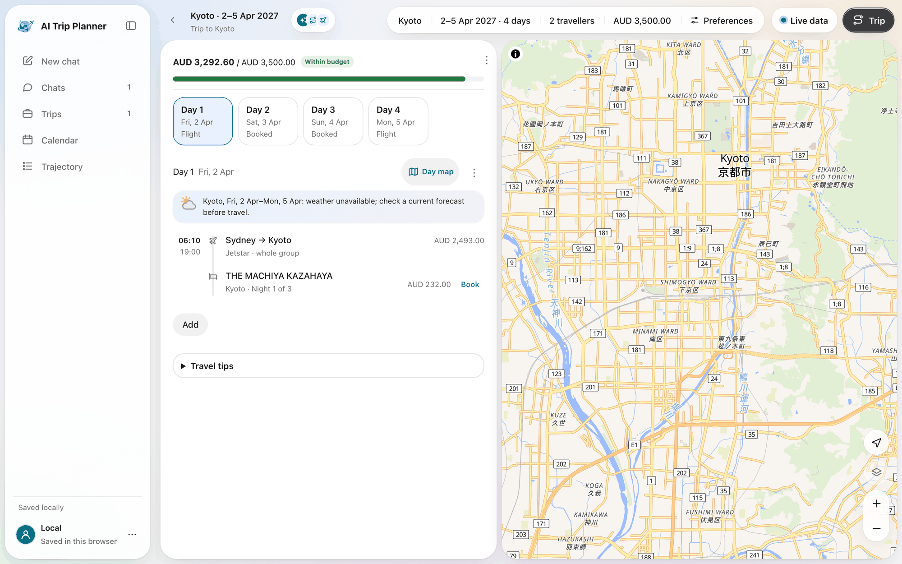
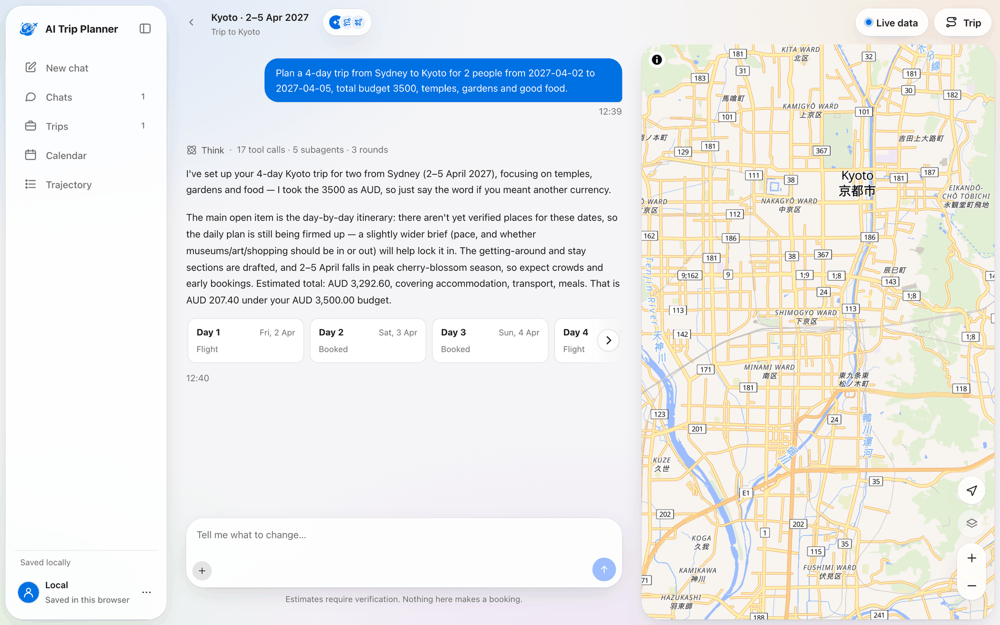
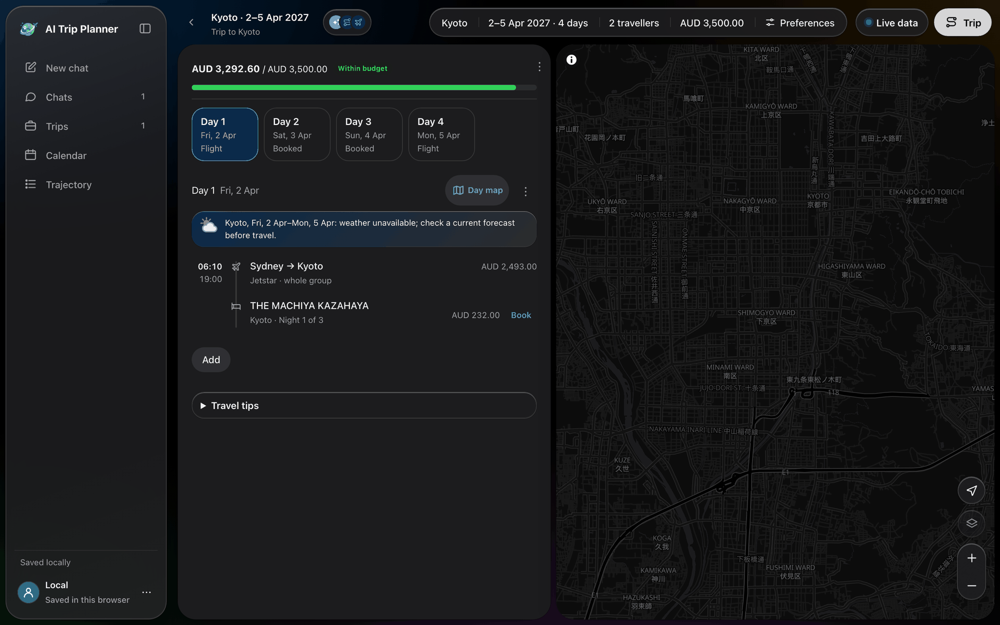
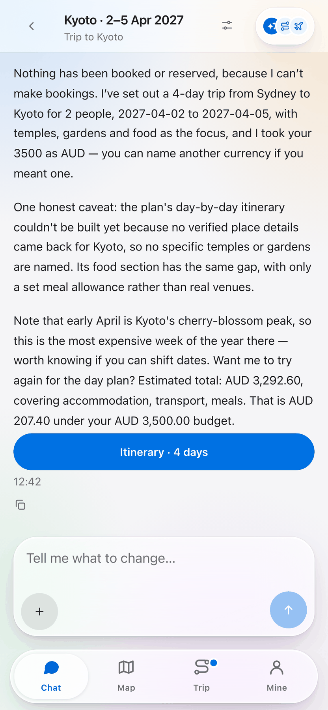
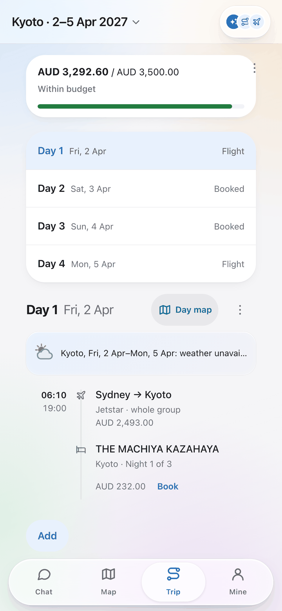
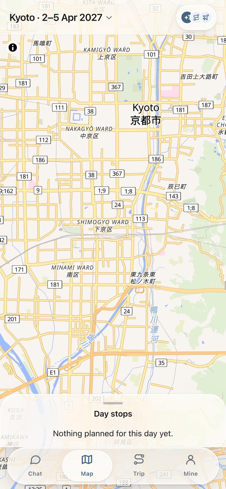
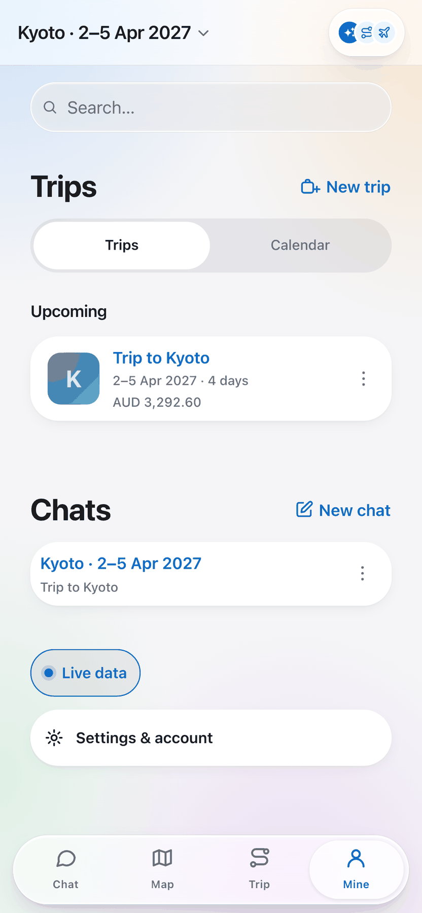
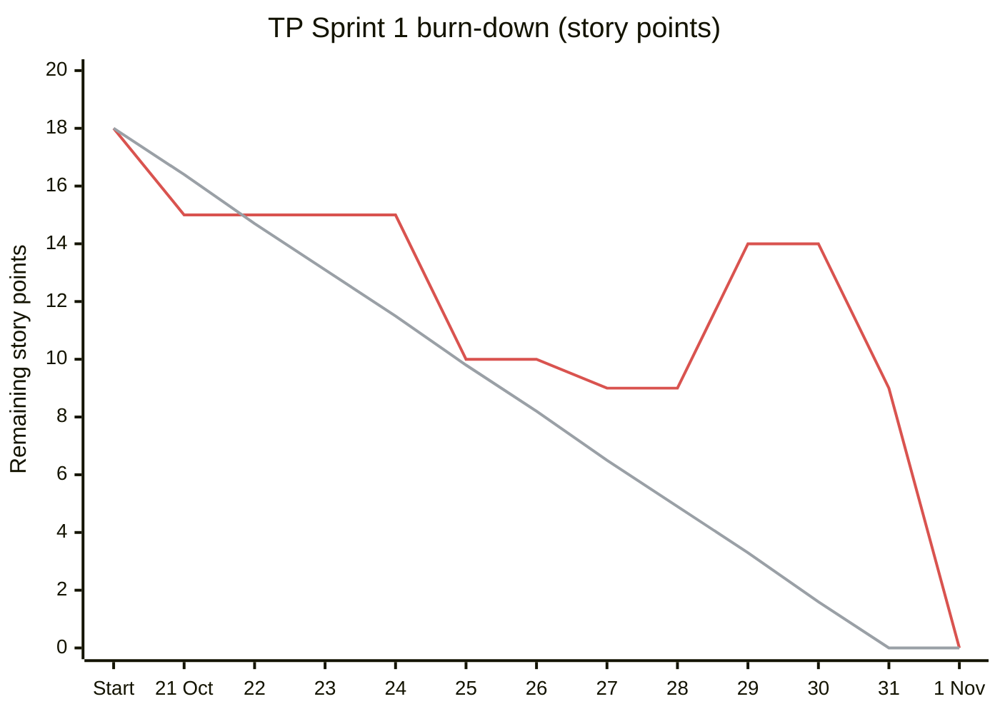
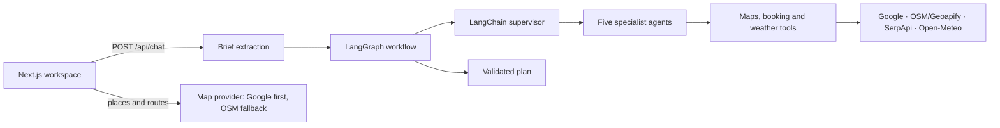

<div align="center">


# AI Trip Planner

**Describe a trip in one sentence; five AI specialists plan it, price it and put it on the map**

[](README.md)
[](README.zh.md)

[](https://elec5620-ai-trip-planner.vercel.app)


[](https://github.com/Lilstanie/AI_TRIP_PLANNER/actions/workflows/ci.yml)



&nbsp;

<sub>The Mac app: the chat that planned the trip (left) and the trip in dark mode (right)</sub>

&nbsp;&nbsp;&nbsp;&nbsp;&nbsp;&nbsp;

<sub>The iPhone app: Chat, Trip, Map and Mine tabs</sub>

</div>

## Features

- **Plan in one sentence.** Say where, when, who and how much. The brief model picks out destinations, dates, party, budget, pace, diet and interests, and asks only for what is missing.
- **Five specialists.** A LangGraph workflow hands the trip to transport, stay, itinerary, dining and guide agents, checks budget and timing conflicts, and sends only the agents involved back for another round.
- **Grounded and priced.** Flights, stays, places, routes and weather come from live providers, and every item says where its data came from. Amounts show in each trip's own currency (AUD, CNY, USD or JPY).
- **Edit any way.** Change the plan by chatting, or directly on the day timeline and the map. Edits apply at once and can be undone.
- **A home for every trip.** Each saved trip has its facts, linked chats, Itinerary, Ideas, Bookings, Trip preferences and Calendar beside the trip map. Your trips adds a Week and Month calendar.
- **See the team work.** @-mention any specialist, watch the Agent Team panel, and open Trajectory for a step-by-step record of what each agent did.
- **Maps that keep working.** Google Maps first; OpenStreetMap and MapLibre take over when Google cannot answer.
- **Synced and remembered.** Trips live in the browser; signed in (Clerk and Neon Postgres), chats, trips and settings sync across devices, and preferences you ask it to remember stay with the account.
- **English and Chinese.** Switch the interface language in Settings; the reply follows the language you write in.
- **Agent Lab.** `/agent-lab` compares planning strategies (one agent, five without revision, targeted revision) on fixed scenarios.

## Platforms

| Platform   | Where        | What it is                                                                                                          |
| ---------- | ------------ | ------------------------------------------------------------------------------------------------------------------- |
| Web        | `apps/web`   | Next.js 15 workspace on Vercel; switches to a phone layout at narrow widths and installs as an app (PWA)            |
| iPhone app | `apps/ios`   | Capacitor shell around the live site, with a liquid-glass look, the system tab bar and Apple Maps on the Map tab    |
| Mac app    | `apps/macos` | Native SwiftUI window around the live site, with Mac cursors, system scrollbars and in-app Apple and GitHub sign-in |

Both native apps load the deployed site, so every web deploy reaches them without a new build.

### Install

- **Web:** open <https://elec5620-ai-trip-planner.vercel.app>. To install it, use Chrome's or Edge's install button, or Safari's Share → Add to Home Screen on an iPhone.
- **iPhone app:** on a Mac with Xcode, run the commands below, pick your Apple ID team under Signing & Capabilities, choose the iPhone and press Run. On the iPhone, trust the developer under Settings → General → VPN & Device Management.

  ```bash
  pnpm install
  pnpm --filter @trip/ios sync
  pnpm --filter @trip/ios open
  ```

- **Mac app:** with the Xcode Command Line Tools, run the script below, then drag `apps/macos/build/AI Trip Planner.app` to Applications. Set `SIGN_IDENTITY` to a Developer ID to sign it for other Macs.

  ```bash
  apps/macos/scripts/build-app.sh
  ```

Email, passcode, Apple and GitHub sign-in stay inside both apps; Google sign-in opens the browser. Details: [iOS app](docs/development.md#ios-app) and [macOS app](docs/development.md#macos-app).

The live demo may lag behind the branch you are reading. The top-bar switch shows whether a request uses mock fixtures or live providers; names labelled “Mock …” come from mock mode, not a failed live integration.

## ELEC5620 Stage 2 report

The unit marks Stage 2 on four criteria ([rubric](docs/design/stage2/demo-marking-criteria.md)). This
section says how the prototype meets each one; every figure and its source is in the
[demo evidence page](docs/design/stage2/demo-evidence.md). Figures are from `main` and Jira project
TP on 1 November 2026.

**1. Functions and features (7).** Every Stage 1 use case and class model names the code that
implements it ([Stage 1 design model](docs/design/stage1/README.md)). Six packages carry 137 test
files with 1,504 tests, and 97 browser end-to-end scripts cover the main journeys. Edge cases are
tested: an infeasible budget, a stalled revision, a rejected Google key, live data unavailable, a
refresh during a reply and signed-out access. A fresh copy of `main` installs and builds in about
1 min 36 s.

**2. AI agent perception, decision-making and interaction (4).** Perception: the brief model turns
free text into destinations, dates, party, budget and intent (pace, diet, interests), and tools read
live flights, stays, places, routes and weather. Decision-making: a LangGraph supervisor chooses
specialists, the graph checks budget and timing conflicts, sends only the agents involved back for
revision and stops with a named reason. Interaction: five specialist assistants, `@`-mentions, the
Agent Team panel and the Trajectory record. On the same A$2,300 trip one agent alone reaches
A$3,960, five specialists without revision A$2,560, and targeted revision A$2,120, within budget
([Agent Lab runs](submission/stage2/agent-lab-exit-paths.md)). A live trip test on 30 October found
22 problems; each became a Jira story and was fixed within two days (PRs #837 to #870).

**3. Agile development (4).** Jira project TP holds 240 issues, 231 done, written as user stories
with acceptance criteria. TP Sprint 1 ran from 21 to 31 October; earlier iterations show in Git as
795 commits on `main` since 24 August. Every pull request carries its TP key, so story, branch, CI
run and merge are linked; 403 pull requests were merged after review and CI. Five recorded
retrospectives changed the team rules, and decisions are kept as
[Agent Notes](.agents/notes/README.md).



The burn-down is rebuilt from the Jira change history of TP Sprint 1 (end-of-day values; red is
remaining work, grey the ideal rate). The sprint started with 18 story points. It stepped up when
stories joined mid-sprint (TP-16 and TP-17 on 21 October, TP-45 and TP-62 on 29 October) and
reached zero on 1 November, when the sprint was closed.

**4. Advanced technologies (5).**

| Technology                                                  | Measured result                                                                   |
| ----------------------------------------------------------- | --------------------------------------------------------------------------------- |
| LangGraph and LangChain multi-agent workflow                | Targeted revision A$2,120 against A$3,960 for a single agent on an A$2,300 budget |
| DeepSeek routing with a deterministic fallback              | About 20 s per page against 37 to 81 s on MiniMax                                 |
| Next.js 15 and React 19 streaming with durable turns        | A reply in progress survives a page refresh                                       |
| Installable app with a phone layout                         | 23/23 installability checks pass                                                  |
| Cloud services: Vercel, Clerk, Neon Postgres, Upstash Redis | 24/24 real sign-in, expiry and account isolation checks pass                      |
| Maps with fallback: Google Maps, OpenStreetMap, MapLibre    | Maps and routes keep working when Google rejects the key                          |
| CI/CD: GitHub Actions, Turborepo, Docker                    | Median pull request CI time fell from 7.3 to 5.3 min                              |

## How it works



| Part          | Where                    | What it does                                                                      |
| ------------- | ------------------------ | --------------------------------------------------------------------------------- |
| Workspace     | `apps/web`               | Next.js UI and API routes: chat, Trip home, map, calendar, Trajectory, Agent Lab  |
| Orchestrator  | `packages/orchestrator`  | LangGraph workflow, supervisor, chat intake, budget and conflict checks, revision |
| Agents        | `packages/agents`        | Five LangChain specialists, DeepSeek routing and deterministic fallbacks          |
| Tools         | `packages/tools`         | Maps, booking, SerpApi and weather adapters, mock fixtures, tool gateway          |
| Contracts     | `packages/shared`        | Zod contracts, plan types and ports shared by every package                       |
| Storage       | `packages/services`      | Memory and trip storage (Redis REST store or in-process)                          |
| Native shells | `apps/ios`, `apps/macos` | iPhone and Mac apps around the deployed site                                      |

The LangGraph graph owns control flow, conflict checks and revision rounds; the supervisor only
chooses which specialists to call. DeepSeek handles chat extraction, the specialists and the reply,
and any missing key or failed model call falls back to validated deterministic output, so requests
still complete. Details: [architecture](docs/architecture.md) and the
[architecture diagrams](docs/architecture-diagrams.md).

## Build from source

Requires Node.js 22+ and pnpm 9.15.0 (selected by `corepack enable`).

```bash
corepack enable
pnpm install
cp .env.example .env.local   # optional keys; mock tools and fallbacks work without them
pnpm dev                     # http://localhost:3000
```

For a demo, use `pnpm dev`: a production server (`pnpm build` and `start`, or Vercel) without Clerk
keys serves mock data only and makes no model calls ([demo runbook](docs/demo-runbook.md)). Set
`GEOAPIFY_API_KEY` (not yet in `.env.example`) to find sights, museums and restaurants through
Geoapify before Overpass.

Environment variables, Google Maps setup, the optional mock server, Docker and the CI checks
(`pnpm typecheck`, `pnpm lint`, `pnpm test`, `pnpm build`) are covered in
[development](docs/development.md).

The Agent Lab benchmark is versioned at 1.0.7; aggregate results and plan quality are not yet
measured. `pnpm --filter @trip/web e2e agent-lab-benchmark` writes a fixture report and replay
screenshot under `output/playwright/agent-lab-benchmark/`; the live subset is opt-in with
`AGENT_LAB_BENCHMARK_LIVE=true` and stays behind the deployment gate. See the
[benchmark guide](docs/development.md#agent-lab-benchmark) and
[release record template](docs/agent-lab-release-record-template.md).

## Repository layout

```text
apps/web/                 Next.js workspace UI and API routes
  components/{workspace,chat,trip,trajectory,map,preferences,account,agent-lab,pwa,ui}
                          UI grouped by feature and shared primitives
  lib/{workspace,chat,trip,trajectory,map,planning,i18n,account,agent-lab,auth,db,dev,integrations}, money.ts
                          integrations and domain rules grouped by responsibility
  tests/{app,components,lib,e2e,cli-e2e,ci,fixtures}
                          web tests and E2E runners, kept separate from production code
apps/ios/                 Capacitor iPhone app around the deployed site
apps/macos/               SwiftUI Mac app around the deployed site
packages/agents/          Five specialist LangChain agents, model routing and fallbacks
  src/                    production agent code by domain
  tests/                  agent tests by domain
packages/orchestrator/    LangGraph workflow, supervisor, chat intake, budget and conflicts
packages/shared/          Zod contracts, plan types and ports
packages/services/        memory and trip storage (Redis REST store or in-process)
packages/tools/           Maps, booking, SerpApi and weather adapters, mock fixtures, tool gateway
docs/                     Documentation of the current system; each package also has a README.md
.agents/                  Decision records, session logs, AI-tool skills and archived plans
```

## Documentation

Browse the [documentation index](docs/README.md) for the full technical guides. Domain terms are defined in the [glossary](GLOSSARY.md).

| Document                                      | Contents                                                    |
| --------------------------------------------- | ----------------------------------------------------------- |
| [Architecture](docs/architecture.md)          | Runtime flow, LangGraph workflow, agents, models, contracts |
| [API](docs/api.md)                            | Every API route with requests, responses and errors         |
| [Development](docs/development.md)            | Setup, environment variables, Docker, verification          |
| [Workspace UI](docs/workspace-ui.md)          | Current UI behaviour, storage, map and editing rules        |
| [Local E2E CLI](docs/local-test-cli.md)       | Running browser journeys locally and reading their reports  |
| [Roadmap](docs/roadmap.md)                    | MVP sequence and status                                     |
| [Team workflow](docs/team-workflow.md)        | Ownership, branches, reviews and session logs               |
| [UI guidelines](docs/design/ui-guidelines.md) | Visual tokens, layout and component design rules            |

The ELEC5620 UML design model and SVG diagrams are in [`docs/design/`](docs/design/class-diagram.md).
Decision records, session logs and AI-tool skills are in [`.agents/`](.agents/README.md); where each
kind of content belongs is set out in [`docs/AGENTS.md`](docs/AGENTS.md).

## Scope

The product target is a single-user flow: describe a trip, inspect grounded recommendations, edit the
plan and save it. Saved trips live in the browser. With accounts configured (Clerk and Neon
Postgres), a signed-in traveller's chats, trips and settings also sync across devices, and preferences the
traveller asks the assistant to remember are stored with the account. Chat turns and the latest plans
are kept in a Redis REST store when one is configured. Status is on the [roadmap](docs/roadmap.md). Multi-user
editing, social features, payments and booking fulfilment are out of scope.

## License

This project is released under the MIT licence; see [LICENSE](LICENSE). Copyright is held by the AI Trip
Planner contributors (ELEC5620 group). Third-party code and its licences are listed in
[THIRD_PARTY_NOTICES.md](THIRD_PARTY_NOTICES.md).
