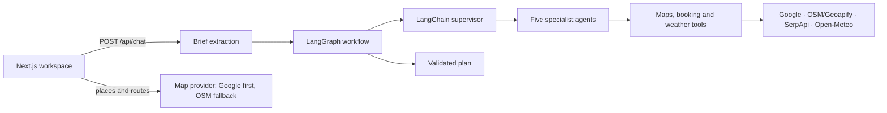

English | [简体中文](README.zh.md)

# AI Trip Planner

[](https://github.com/Lilstanie/AI_TRIP_PLANNER/actions/workflows/ci.yml)

AI Trip Planner is a single-user, multi-agent travel workspace. A user describes a trip in chat or
edits its facts from the top-bar chips; a LangGraph workflow delegates to five LangChain specialist agents and returns a
validated plan with itinerary, transport, accommodation, dining, destination guidance and budget,
each labelled with where its data came from. The user edits the plan by chatting or directly on the
day timeline and map (Google first, OpenStreetMap when Google cannot answer), and saves trips in the
browser, optionally synced to an account across devices.

Each saved trip has a Trip home: its facts, the chats linked to it, a composer for a new chat, and
Itinerary, Ideas, Bookings, Trip preferences and Calendar panels beside the trip map. Your trips lists
every trip and a Week and Month calendar. In chat the traveller can @-mention any of the five
specialists, see the Agent Team at work, and open Trajectory for a step-by-step record of
what each agent did.

The interface is available in English and Chinese, shows each trip's amounts in its own display
currency, switches to a phone layout at narrow widths and can be installed as an app. A separate
`/agent-lab` page compares planning strategies on fixed scenarios.

The Agent Lab benchmark is versioned at 1.0.7. Aggregate results are not yet measured, and plan
quality has not yet been assessed. Run `pnpm --filter @trip/web e2e agent-lab-benchmark` to generate
a fixture report and replay screenshot under `output/playwright/agent-lab-benchmark/`; the live subset
is separately opt-in with `AGENT_LAB_BENCHMARK_LIVE=true` and remains subject to the deployment gate.
See the [benchmark guide](docs/development.md#agent-lab-benchmark) and
[release record template](docs/agent-lab-release-record-template.md).

Live demo: [elec5620-ai-trip-planner.vercel.app](https://elec5620-ai-trip-planner.vercel.app). The
top-bar toggle shows whether a request uses mock fixtures or live providers; place and hotel names
labelled “Mock …” come from mock mode, not a failed live integration. The demo may lag behind the
branch you are reading.

## ELEC5620 Stage 2 report

The unit marks Stage 2 on four criteria ([rubric](docs/design/stage2/demo-marking-criteria.md)). This
section says how the prototype meets each one; every figure and its source is in the
[demo evidence page](docs/design/stage2/demo-evidence.md). Figures are from `main` and Jira project
TP on 1 November 2026.

**1. Functions and features (7).** Every Stage 1 use case and class model names the code that
implements it ([Stage 1 design model](docs/design/stage1/README.md)). Six packages carry 137 test
files with 1,504 tests, and 97 browser end-to-end scripts cover the main journeys. Edge cases are
tested: an infeasible budget, a stalled revision, a rejected Google key, live data unavailable, a
refresh during a reply and signed-out access. A fresh copy of `main` installs and builds in about
1 min 36 s.

**2. AI agent perception, decision-making and interaction (4).** Perception: the brief model turns
free text into destinations, dates, party, budget and intent (pace, diet, interests), and tools read
live flights, stays, places, routes and weather. Decision-making: a LangGraph supervisor chooses
specialists, the graph checks budget and timing conflicts, sends only the agents involved back for
revision and stops with a named reason. Interaction: five specialist assistants, `@`-mentions, the
Agent Team panel and the Trajectory record. On the same A$2,300 trip one agent alone reaches
A$3,960, five specialists without revision A$2,560, and targeted revision A$2,120, within budget
([Agent Lab runs](submission/stage2/agent-lab-exit-paths.md)). A live trip test on 30 October found
22 problems; each became a Jira story and was fixed within two days (PRs #837 to #870).

**3. Agile development (4).** Jira project TP holds 238 issues, 230 done, written as user stories
with acceptance criteria. TP Sprint 1 ran from 21 to 31 October; earlier iterations show in Git as
795 commits on `main` since 24 August. Every pull request carries its TP key, so story, branch, CI
run and merge are linked; 403 pull requests were merged after review and CI. Five recorded
retrospectives changed the team rules, and decisions are kept as
[Agent Notes](.agents/notes/README.md).

**4. Advanced technologies (5).**

| Technology                                                  | Measured result                                                                   |
| ----------------------------------------------------------- | --------------------------------------------------------------------------------- |
| LangGraph and LangChain multi-agent workflow                | Targeted revision A$2,120 against A$3,960 for a single agent on an A$2,300 budget |
| DeepSeek routing with a deterministic fallback              | About 20 s per page against 37 to 81 s on MiniMax                                 |
| Next.js 15 and React 19 streaming with durable turns        | A reply in progress survives a page refresh                                       |
| Installable app with a phone layout                         | 23/23 installability checks pass                                                  |
| Cloud services: Vercel, Clerk, Neon Postgres, Upstash Redis | 24/24 real sign-in, expiry and account isolation checks pass                      |
| Maps with fallback: Google Maps, OpenStreetMap, MapLibre    | Maps and routes keep working when Google rejects the key                          |
| CI/CD: GitHub Actions, Turborepo, Docker                    | Median pull request CI time fell from 7.3 to 5.3 min                              |

## How it works



The LangGraph graph owns control flow, conflict checks and revision rounds; the supervisor only
chooses which specialists to call. DeepSeek handles chat extraction, the specialists and the reply,
and any missing key or failed model call falls back to validated deterministic output, so requests
still complete. Details: [architecture](docs/architecture.md) and the
[architecture diagrams](docs/architecture-diagrams.md).

## Quick start

Requires Node.js 22+ and pnpm 9.15.0 (selected by `corepack enable`).

```bash
corepack enable
pnpm install
cp .env.example .env.local   # optional keys; mock tools and fallbacks work without them
pnpm dev                     # http://localhost:3000
```

For a demo, use `pnpm dev`: a production server (`pnpm build` and `start`, or Vercel) without Clerk
keys serves mock data only and makes no model calls ([demo runbook](docs/demo-runbook.md)). Set
`GEOAPIFY_API_KEY` (not yet in `.env.example`) to find sights, museums and restaurants through
Geoapify before Overpass.

Environment variables, Google Maps setup, the optional mock server, Docker and the CI checks
(`pnpm typecheck`, `pnpm lint`, `pnpm test`, `pnpm build`) are covered in
[development](docs/development.md).

## Repository layout

```text
apps/web/                 Next.js workspace UI and API routes
  components/{workspace,chat,trip,trajectory,map,preferences,account,agent-lab,pwa,ui}
                          UI grouped by feature and shared primitives
  lib/{workspace,chat,trip,trajectory,map,map-provider,planning,i18n,account,agent-lab,auth,db,dev,integrations}, money.ts
                          integrations and domain rules grouped by responsibility
  tests/{app,components,lib,e2e,cli-e2e,ci,fixtures}
                          web tests and E2E runners, kept separate from production code
packages/agents/          Five specialist LangChain agents, model routing and fallbacks
  src/                    production agent code by domain
  tests/                  agent tests by domain
packages/orchestrator/    LangGraph workflow, supervisor, chat intake, budget and conflicts
packages/shared/          Zod contracts, plan types and ports
packages/services/        memory and trip storage (Redis REST store or in-process)
packages/tools/           Maps, booking, SerpApi and weather adapters, mock fixtures, tool gateway
docs/                     Documentation of the current system; each package also has a README.md
.agents/                  Decision records, session logs, AI-tool skills and archived plans
```

## Documentation

Browse the [documentation index](docs/README.md) for the full technical guides. Domain terms are defined in the [glossary](GLOSSARY.md).

| Document                                      | Contents                                                    |
| --------------------------------------------- | ----------------------------------------------------------- |
| [Architecture](docs/architecture.md)          | Runtime flow, LangGraph workflow, agents, models, contracts |
| [API](docs/api.md)                            | Every API route with requests, responses and errors         |
| [Development](docs/development.md)            | Setup, environment variables, Docker, verification          |
| [Workspace UI](docs/workspace-ui.md)          | Current UI behaviour, storage, map and editing rules        |
| [Local E2E CLI](docs/local-test-cli.md)       | Running browser journeys locally and reading their reports  |
| [Roadmap](docs/roadmap.md)                    | MVP sequence and status                                     |
| [Team workflow](docs/team-workflow.md)        | Ownership, branches, reviews and session logs               |
| [UI guidelines](docs/design/ui-guidelines.md) | Visual tokens, layout and component design rules            |

The ELEC5620 UML design model and SVG diagrams are in [`docs/design/`](docs/design/class-diagram.md).
Decision records, session logs and AI-tool skills are in [`.agents/`](.agents/README.md); where each
kind of content belongs is set out in [`docs/AGENTS.md`](docs/AGENTS.md).

## Scope

The product target is a single-user flow: describe a trip, inspect grounded recommendations, edit the
plan and save it. Saved trips live in the browser. With accounts configured (Clerk and Neon
Postgres), a signed-in traveller's chats, trips and settings also sync across devices, and preferences the
traveller asks the assistant to remember are stored with the account. Chat turns and the latest plans
are kept in a Redis REST store when one is configured. Status is on the [roadmap](docs/roadmap.md). Multi-user
editing, social features, payments and booking fulfilment are out of scope.

## License

This project is released under the MIT licence; see [LICENSE](LICENSE). Copyright is held by the AI Trip
Planner contributors (ELEC5620 group). Third-party code and its licences are listed in
[THIRD_PARTY_NOTICES.md](THIRD_PARTY_NOTICES.md).
