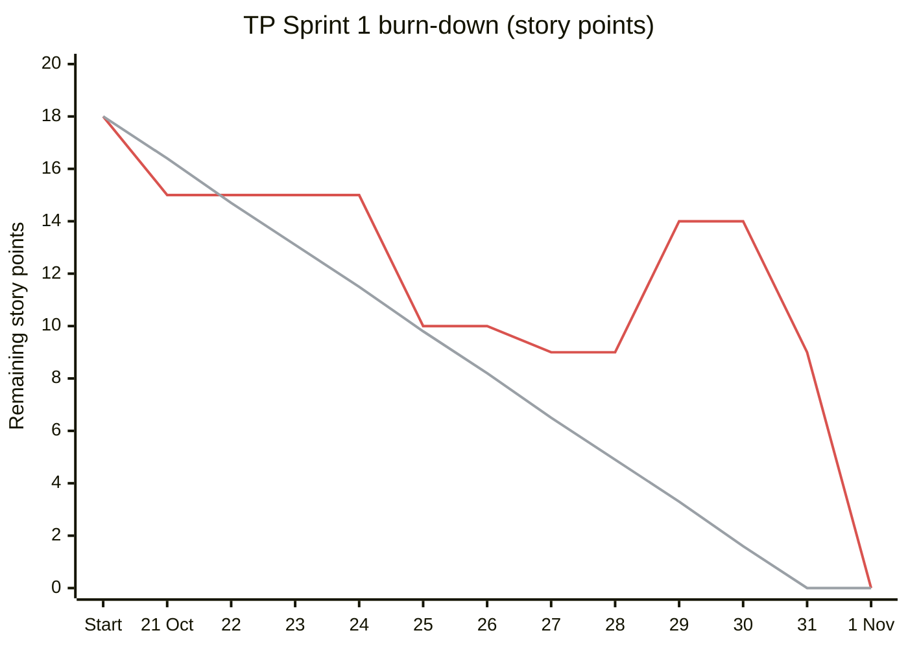
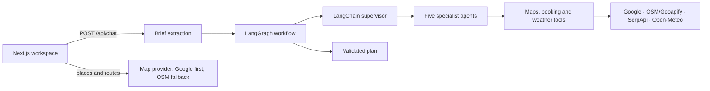

[English](README.md) | 简体中文

# AI Trip Planner

[](https://github.com/Lilstanie/AI_TRIP_PLANNER/actions/workflows/ci.yml)

AI Trip Planner 是一个面向单个用户的多智能体旅行工作区。用户可以在对话中描述行程，也可以通过顶部栏的信息标签修改行程事实。LangGraph 工作流会调度五个 LangChain 专家 agent，生成经过校验的旅行计划，包含日程、交通、住宿、餐饮、目的地指南和预算，并为每项信息标注数据来源。用户可以继续通过对话、按天排列的时间线和地图（优先使用 Google，Google 无法响应时改用 OpenStreetMap）编辑计划，并将行程保存在浏览器中，也可以通过账号在多台设备间同步。

每个保存的行程都有 Trip home：行程事实、关联的聊天、新聊天的输入框，以及在行程地图旁打开的 Itinerary、Ideas、Bookings、Trip preferences 和 Calendar 面板。Your trips 页面列出所有行程，并提供周视图和月视图日历。在聊天中，用户可以 @ 提及五位 specialist 中的任意一位，查看 Agent Team 的工作状态，并打开 Trajectory 逐步查看每个 agent 做了什么。

界面支持中英文，每个行程的金额按该行程自己的显示币种展示，窄屏下切换为手机布局，并可作为应用安装。独立的 `/agent-lab` 页面在固定场景上对比不同的规划策略。

Agent Lab 基准版本为 1.0.7。汇总结果尚未测量，计划质量也尚未评估。运行
`pnpm --filter @trip/web e2e agent-lab-benchmark` 可在
`output/playwright/agent-lab-benchmark/` 生成 fixture 报告和回放截图；实时子集需通过
`AGENT_LAB_BENCHMARK_LIVE=true` 单独启用，且仍受部署门控限制。详见[基准指南](docs/development.zh.md#agent-lab-benchmark)
和[发布记录模板](docs/agent-lab-release-record-template.md)。

在线演示：[elec5620-ai-trip-planner.vercel.app](https://elec5620-ai-trip-planner.vercel.app)。顶部栏的切换开关会显示请求使用模拟数据还是实时数据提供方；地点和酒店名称中带有“Mock …”的内容来自模拟模式，并不表示实时集成失败。演示站点的版本可能落后于你正在查看的分支。

<a id="elec5620-stage-2-report"></a>

## ELEC5620 Stage 2 报告

课程按四项标准给 Stage 2 打分（[评分标准](docs/design/stage2/demo-marking-criteria.zh.md)）。本节说明原型如何满足每一项；所有数字及其来源见[演示证据页](docs/design/stage2/demo-evidence.zh.md)。数字取自 2026 年 11 月 1 日的 `main` 和 Jira 项目 TP。

**1. 功能与特性（7）。** 每个 Stage 1 用例和类模型都写明了实现它的代码（[Stage 1 设计模型](docs/design/stage1/README.zh.md)）。六个包共有 137 个测试文件、1,504 个测试，97 个浏览器端到端脚本覆盖主要流程。边界情况都有测试：预算不可行、返工停滞、Google key 被拒、真实数据不可用、回复中途刷新和未登录访问。`main` 的全新副本安装并构建约 1 分 36 秒。

**2. AI Agent 的感知、决策与交互（4）。** 感知：需求模型把自由文本转成目的地、日期、出行人、预算和意图（节奏、饮食、兴趣），工具读取实时航班、住宿、地点、路线和天气。决策：LangGraph 的 supervisor 选择专家，图检查预算和时间冲突，只让相关 agent 返工，并以明确的原因停止。交互：五个专家助手、`@`-mentions、专家团队面板和执行轨迹。同一个 A$2,300 的行程，单个 agent 报价 A$3,960，五个专家不返工 A$2,560，定向返工 A$2,120，在预算内（[Agent Lab 运行记录](submission/stage2/agent-lab-exit-paths.md)）。10 月 30 日一次真实行程测试发现 22 个问题，每个都建成 Jira 故事，两天内修复（PR #837 到 #870）。

**3. 敏捷开发（4）。** Jira 项目 TP 共 240 个条目，231 个已完成，均按带验收标准的用户故事书写。TP Sprint 1 从 10 月 21 日持续到 31 日；更早的迭代体现在 Git 中：8 月 24 日以来 `main` 共 795 个提交。每个 PR 都带 TP 编号，故事、分支、CI 运行和合并都连在一起；403 个 PR 经评审和 CI 后合并。五次有记录的回顾改了团队规则，决策记录为 [Agent Notes](.agents/notes/README.md)。



燃尽图由 Jira 中 TP Sprint 1 的变更历史重建（取每天结束时的值，红线是剩余工作量，灰线是理想速率）。冲刺开始时有 18 个故事点；冲刺中途加入故事时曲线回升（10 月 21 日加入 TP-16 和 TP-17，10 月 29 日加入 TP-45 和 TP-62），11 月 1 日关闭冲刺时降到零。

**4. 先进技术（5）。**

| 技术                                                | 实测结果                                         |
| --------------------------------------------------- | ------------------------------------------------ |
| LangGraph 和 LangChain 多 agent 工作流              | A$2,300 预算下定向返工 A$2,120，单 agent A$3,960 |
| DeepSeek 路由加确定性回退                           | 每页约 20 秒，MiniMax 为 37 到 81 秒             |
| Next.js 15 和 React 19 流式输出与持久回合           | 进行中的回复在页面刷新后不会丢                   |
| 可安装应用和手机布局                                | 可安装性检查 23/23 通过                          |
| 云服务：Vercel、Clerk、Neon Postgres、Upstash Redis | 真实登录、过期和账号隔离检查 24/24 通过          |
| 地图回退：Google Maps、OpenStreetMap、MapLibre      | Google 拒绝 key 时地图和路线仍可用               |
| CI/CD：GitHub Actions、Turborepo、Docker            | PR 的 CI 中位时长从 7.3 分钟降到 5.3 分钟        |

## 工作原理



LangGraph 图负责控制流程、冲突检查和修订轮次；supervisor 只负责选择要调用哪些专家。DeepSeek 负责从对话中提取需求、驱动专家并生成回复。如果缺少密钥或模型调用失败，系统会回退到经过校验的确定性结果，因此请求仍可完成。详情见[架构文档](docs/architecture.zh.md)和[架构图](docs/architecture-diagrams.zh.md)。

## 快速开始

需要 Node.js 22 或更高版本，以及 pnpm 9.15.0（由 `corepack enable` 选择）。

```bash
corepack enable
pnpm install
cp .env.example .env.local   # optional keys; mock tools and fallbacks work without them
pnpm dev                     # http://localhost:3000
```

演示请用 `pnpm dev`：没有 Clerk 密钥的生产服务器（`pnpm build` 加 `start`，或 Vercel）只提供模拟数据，也不调用模型（见[演示手册](docs/demo-runbook.zh.md)）。设置 `GEOAPIFY_API_KEY`（`.env.example` 里还没有）后，景点、博物馆和餐厅会先从 Geoapify 查找，再退到 Overpass。

环境变量、Google Maps 配置、可选模拟服务器、Docker 和 CI 检查（`pnpm typecheck`、`pnpm lint`、`pnpm test`、`pnpm build`）详见[开发文档](docs/development.zh.md)。

## 仓库目录

```text
apps/web/                 Next.js workspace UI and API routes
  components/{workspace,chat,trip,trajectory,map,preferences,account,agent-lab,pwa,ui}
                          UI grouped by feature and shared primitives
  lib/{workspace,chat,trip,trajectory,map,map-provider,planning,i18n,account,agent-lab,auth,db,dev,integrations}, money.ts
                          integrations and domain rules grouped by responsibility
  tests/{app,components,lib,e2e,cli-e2e,ci,fixtures}
                          web tests and E2E runners, kept separate from production code
packages/agents/          Five specialist LangChain agents, model routing and fallbacks
  src/                    production agent code by domain
  tests/                  agent tests by domain
packages/orchestrator/    LangGraph workflow, supervisor, chat intake, budget and conflicts
packages/shared/          Zod contracts, plan types and ports
packages/services/        memory and trip storage (Redis REST store or in-process)
packages/tools/           Maps, booking, SerpApi and weather adapters, mock fixtures, tool gateway
docs/                     Documentation of the current system; each package also has a README.md
.agents/                  Decision records, session logs, AI-tool skills and archived plans
```

## 文档

完整技术文档见[中文文档索引](docs/README.zh.md)。领域术语见[术语表](GLOSSARY.md)（英文）。

| 文档                                           | 内容                                           |
| ---------------------------------------------- | ---------------------------------------------- |
| [架构](docs/architecture.zh.md)                | 运行流程、LangGraph 工作流、agents、模型和契约 |
| [API](docs/api.zh.md)                          | 全部 API 路由的请求、响应和错误                |
| [开发](docs/development.zh.md)                 | 环境配置、环境变量、Docker 和验证              |
| [工作区界面](docs/workspace-ui.zh.md)          | 当前界面行为、存储、地图和编辑规则             |
| [本地 E2E CLI](docs/local-test-cli.zh.md)      | 在本地运行浏览器流程并读取运行报告             |
| [路线图](docs/roadmap.zh.md)                   | MVP 阶段和当前状态                             |
| [团队工作流](docs/team-workflow.zh.md)         | 职责、分支、审查和 session logs                |
| [UI 设计指南](docs/design/ui-guidelines.zh.md) | 视觉 tokens、布局和组件设计规则                |

ELEC5620 UML 设计模型和 SVG 图表位于 [`docs/design/`](docs/design/class-diagram.zh.md)。决策记录、session logs 和 AI 工具技能位于 [`.agents/`](.agents/README.md)；各类内容的归属说明见 [`docs/AGENTS.md`](docs/AGENTS.md)。

## 项目范围

产品目标是支持单用户完成整个旅行规划流程：描述行程、查看有依据的建议、编辑计划并保存。已保存的行程位于浏览器中。配置账号（Clerk 和 Neon Postgres）后，已登录旅客的对话、行程和设置还会在多台设备间同步；旅客让助手记住的偏好会随账号保存。配置 Redis REST store 后，对话轮次和最新计划也会保存在其中。当前状态见[路线图](docs/roadmap.zh.md)。多人协作编辑、社交功能、支付和实际预订履约不在项目范围内。

## 许可

本项目以 MIT 许可发布，见 [LICENSE](LICENSE)。版权归 AI Trip Planner 贡献者（ELEC5620 小组）所有。第三方代码及其许可见 [THIRD_PARTY_NOTICES.md](THIRD_PARTY_NOTICES.md)。
