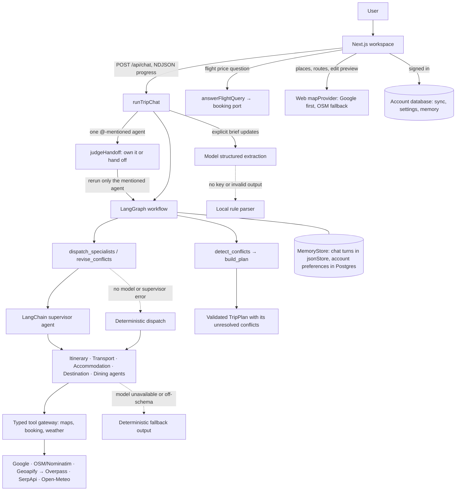
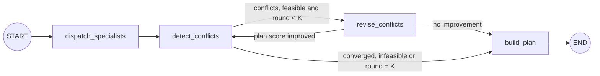

<a id="architecture"></a>

# 架构

[English](architecture.md) | 中文

AI Trip Planner 是一个由工作区包支撑的 Next.js 可部署单元。确定性的 LangGraph 工作流
负责规划控制流程，LangChain agent（智能体）在其中执行各自角色的推理。
请求、agent、数据提供方、持久化和工作区流程的交互式图表见[架构流程图索引](architecture-diagrams.zh.md)。

<a id="change-entry-points"></a>

## 更改入口

编辑前，使用这张表找到更改所属的模块。各包 README 说明其导出和配置；
[开发指南](development.zh.md)负责环境设置、目录和验证规则。

| 更改领域                             | 从这里开始                                | 继续追踪                                                                                                                                                                                                                                  |
| ------------------------------------ | ----------------------------------------- | ----------------------------------------------------------------------------------------------------------------------------------------------------------------------------------------------------------------------------------------- |
| 聊天请求与流式回复                   | `apps/web/app/api/chat/route.ts`          | `packages/orchestrator/src/chat.ts`、共享聊天约定和聊天 UI                                                                                                                                                                                |
| 规划状态、冲突检查或 specialist 流程 | `packages/orchestrator/src/workflow.ts`   | `packages/agents/src/`、经过验证的计划约定、持久化和工作区消费方                                                                                                                                                                          |
| 共享请求、提案或计划的数据结构       | `packages/shared/src/`                    | 每个生产方和消费方；在同一更改中新增 Agent Note                                                                                                                                                                                           |
| 地图、预订或天气依据                 | `packages/tools/src/gateway.ts`           | 带类型的端口、提供方适配器、回退标签和 agent 消费方；提供方工作使用 [add-provider](../.agents/skills/add-provider/SKILL.md)                                                                                                               |
| 保存的聊天、偏好或旅行               | `packages/services/src/`                  | 浏览器存储、API 路由和工作区恢复行为                                                                                                                                                                                                      |
| 账号、登录与跨设备同步               | `apps/web/lib/account/`                   | [API](api.zh.md#account-routes) 中的账号路由、`apps/web/lib/db/schema.ts`、[基于修订号的同步决策](../.agents/notes/implemented/bug-fix/2026-10-14-revision-based-account-sync.md)和[工作区界面](workspace-ui.zh.md#accounts-and-settings) |
| 可见工作区或交互行为                 | `apps/web/components/` 和 `apps/web/lib/` | [工作区 UI](workspace-ui.zh.md)、设计规则和 [ui-verification](../.agents/skills/ui-verification/SKILL.md)                                                                                                                                 |

跨越这些边界的更改，使用
[end-to-end-feature-wiring](../.agents/skills/end-to-end-feature-wiring/SKILL.md)
从值的生产方一路追踪到最终面向用户的消费方。

<a id="runtime-flow"></a>

## 运行时流程



LangGraph 工作流驱动 supervisor，而不是反过来：图决定何时分派、修订和停止，
supervisor 只选择某个节点需要哪些 specialist 工具。控制路径、预算红线和停止条件
从不依赖模型临时决定下一步。

1. `POST /api/chat` 调用 `runTripChat`（`packages/orchestrator/src/chat.ts`），只从消息中
   提取明确的 `TripBrief` 更新。`mode: "plan"` 跳过提取，规划提交的行程需求；
   `mode: "start"` 要求消息中包含所有行程需求字段（见 [API](api.zh.md)）。
   所有入口都通过 `packages/orchestrator/src/brief-intake.ts` 中的 `BriefIntake` 合并明确的修订，
   并统一判断是否就绪：可规划、信息不全、目的地有歧义，或历史日期需要确认。
   模型补齐行程需求后，即使没有调用 `replan_trip`，也会经过同一个检查入口。
   历史日期确认由最近一条助手 `ChatTurn.pendingBriefConfirmation` 绑定具体起止日期，
   并要求旅行者明确回复；提示文案不承载状态，旧的纯文本提示会重新询问。
   服务端的 `ChatTurn.confirmedBriefDestination` 让完整地名的确认在后续问题中保留，
   地名改变时该确认失效。匹配目的地的坐标决定当地日期；已有计划仍可编辑。参见[接收决策](../.agents/notes/implemented/architecture/2026-10-25-brief-intake.md)。
2. 工作流运行 specialist、检测冲突、对目标 specialist 最多执行 `maxRounds` 轮修订，
   然后组装 `TripPlan`。计划的各部分分别携带自己的草稿/需要用户处理状态，
   `conflicts` 列出仍未解决的请求。
3. 进度事件以 NDJSON 流式发送到浏览器；最终帧携带 `{ reply, plan }`。
4. 完成信息接收后，旅行者通过聊天说明或编辑行程来修改计划，无需批准检查点。
   地图查询和行程编辑预览使用 `apps/web` 中的地图路由，绝不会重新运行规划器。

<a id="web-map-providers"></a>

<a id="web-map-providers"></a>

## Web 地图提供方

Web 工作区的地点搜索、地点详情、地点照片、行程段路线、从旅行者当前位置出发的路线以及目的地时区，
都通过 `apps/web/lib/map-provider/` 中的同一个 `MapProvider` 接口完成。Google Maps Platform 优先应答。
Google 无法应答时，改由基于 OpenStreetMap 的免费提供方应答：Photon/Nominatim 提供搜索和详情，Commons
提供可选的许可照片，OSRM 提供步行、骑行及驾车，Transitous 提供公共交通，坐标在离线状态下解析时区。
[完成决策](../.agents/notes/implemented/architecture/2026-10-10-complete-map-fallback.md)记录了边界。

- **不可用**指：没有 `MAPS_API_KEY`；Google 拒绝访问（401、403、无效密钥、API 已停用或未开通结算）；
  配额耗尽（429，或 Time Zone 返回 `OVER_QUERY_LIMIT`）；Google 服务端错误（5xx）；超时或网络故障。
  空的搜索结果、未知地点（400 或 404）或明确的拒绝都是应答，绝不触发回退。
- **冷却期：**发生访问或配额失败后，服务器在 `GOOGLE_MAPS_COOLDOWN_SECONDS`（默认 300）内跳过 Google，
  之后再重试。冷却状态保存在每个服务器进程的内存中。
- **选择：**`WEB_MAPS_PROVIDER` 可取 `google-with-fallback`（默认）、`google`（绝不回退）或 `osm`。
  它与 agent 使用的 `MAPS_PROVIDER` 相互独立。
- **地点 ID** 是带提供方前缀的字符串：`osm:node/123`、`osm:way/456`、`osm:relation/789`；没有前缀的 ID
  属于 Google。某个 ID 的详情、照片和路线只发给签发它的提供方。
- **来源标注：**`/api/places/search` 和 `/api/places/details` 的应答带有 `source` 字段（`google` 或
  `osm`），`/api/places/photo` 在重定向中发送 `X-Map-Provider` 头，每个路线结果都带有 `source`。
  路径和应答的其余部分保持不变。
- **模拟数据模式：**`MOCK_GOOGLE_MAPS=unavailable` 让 Google 提供方在不调用 Google 的情况下以不可用失败，
  仅对处于模拟数据模式的请求生效（取 `x-trip-data-mode` 请求头，否则取 `USE_MOCK_TOOLS`）。实时模式下忽略。
  模拟模式下的编辑预览保持占位 fixture，且不会触达任何提供方，除非 Google 被模拟为不可用或 `WEB_MAPS_PROVIDER=osm`；
  此时提供方从 OpenStreetMap fixture 应答，同样不调用任何外部服务。

<a id="routes-and-time-zones-without-google"></a>

### 没有 Google 时的路线与时区

- **步行和驾车**来自 OSRM。步行请求 `OSRM_FOOT_BASE_URL` 的步行（foot）配置（默认
  `https://routing.openstreetmap.de/routed-foot`，即 FOSSGIS 的步行实例），驾车请求 `OSRM_BASE_URL`
  （默认 `https://router.project-osrm.org`）。公共演示服务器只提供汽车路线，并忽略请求的配置，因此绝不用于步行。
  两个基础 URL 都可以指向自建或付费的 OSRM 实例。
- **骑行**使用 `OSRM_BIKE_BASE_URL` 的自行车（bike）配置（默认
  `https://routing.openstreetmap.de/routed-bike`），与步行和驾车实例独立。
  时间线将所选方式保存为 `cycle`；Google 可用时收到 `BICYCLE`。
- **公共交通**使用 Transitous/MOTIS `GET /api/v6/plan`，发送坐标和出发时刻。只有包含公共交通路段的方案才提供时长；仅步行的结果表示没有路线。空结果和服务故障都不会变成估算公交时间。Transitous 应答带有 `source: "transitous"`，界面链接其数据来源。
- **来源标注：**由 OSRM 应答的路线带有 `source: "osrm"`，时间线上的时间标为 `OSRM`（Google 的时间标为 `Google`）。
  从旅行者当前位置出发的路线在地图上标为 `OSRM routes`。已保存在行程中的路段不保留服务标签，因为 `arriveBy` 没有提供方字段，
  增加它会改变共享契约；只有当前编辑应答的路线带有标签。
- **失败处理：**OSRM 返回 `NoRoute` 是一个应答，即该路段没有路线。服务器错误、超时、网络故障或没有时长的应答都是不可用；
  该路段不保留时间，并显示带重试的提示，不以估计值代替。
- **缓存与限制：**已应答的路段在服务器内存中保留 10 分钟，失败的结果不缓存。OSRM 政策要求每秒最多一个请求；
  本客户端不做自我限流，因此缓存是唯一的节流手段，请求量大的部署应自建 OSRM。
- **时区**在 Google 时区调用失败时，通过 `@photostructure/tz-lookup`（CC0 数据，不发起网络请求）离线计算。
  其边界经过简化，距离边界几公里内的地点可能得到相邻时区。没有坐标的地点没有时区，会被拒绝，绝不假定为 UTC。
- **模拟数据模式：**在 `MOCK_GOOGLE_MAPS=unavailable` 下，编辑预览通过提供方为路段规划路线和时间；提供方以 fixture
  应答 OSRM（按直线距离、步行或驾车速度计算，见 `apps/web/lib/map-provider/mock-osm.ts`），地点也取自同一文件。
  不发出任何 OSRM 请求。

<a id="free-services-limits-and-terms"></a>

### 免费服务：限制与条款

2026-10-09 依据各运营方公布的政策核对。这些服务都没有 SLA，任何一家都可能限流或封禁不遵守其政策的客户端。

| 服务                                                                                                          | 用途                                                                                                                   | 限制与条款                                                                                                                                                                                                    |
| ------------------------------------------------------------------------------------------------------------- | ---------------------------------------------------------------------------------------------------------------------- | ------------------------------------------------------------------------------------------------------------------------------------------------------------------------------------------------------------- |
| [OpenFreeMap](https://openfreemap.org/)                                                                       | 矢量地图瓦片（MapLibre）                                                                                               | 无需密钥、无需注册，未公布请求上限；允许商业使用；无 SLA。MapLibre 的署名控件即满足署名要求；其他客户端需显示 "OpenFreeMap © OpenMapTiles Data from OpenStreetMap"。                                          |
| [Photon](https://github.com/komoot/photon)（`photon.komoot.io`）                                              | 地点搜索                                                                                                               | 只要请求量保持在合理范围内即可免费使用；大量使用会被限流或封禁；未公布具体数值；不保证可用性。量大时应自行部署。                                                                                              |
| [Nominatim](https://operations.osmfoundation.org/policies/nominatim/)                                         | Photon 之后的搜索、地点详情                                                                                            | 整个应用（所有用户合计）每秒最多 1 个请求；必须带有可识别的 `User-Agent` 或 `Referer`（不接受库的默认值）；须缓存结果；禁止客户端自动补全；禁止批量或系统性查询；遵守 ODbL 署名。                             |
| [Geoapify Places](https://apidocs.geoapify.com/docs/places/)（`api.geoapify.com`）                            | 设置 `GEOAPIFY_API_KEY` 时，智能体在城市中心 15 公里内查景点、博物馆和餐厅（`MAPS_PROVIDER=osm`）；失败时退回 Overpass | 免费套餐每天 3,000 积分，每个部署需要自己的账号和 key；数据来自 OSM，遵守 ODbL 署名。                                                                                                                         |
| [Overpass API](https://wiki.openstreetmap.org/wiki/Overpass_API)（`overpass-api.de`）                         | 智能体按 OSM 标签查景点、街区和餐厅（`MAPS_PROVIDER=osm`）                                                             | 公共实例供适度使用：每天约 10,000 次查询和 1 GB 数据，每个 IP 只有少量并发槽位，不保证可用；遵守 ODbL 署名。请求量大时自建或换用其他实例。                                                                    |
| [OSRM 演示服务器](https://github.com/Project-OSRM/osrm-backend/wiki/Demo-server)（`router.project-osrm.org`） | 驾车时间（仅汽车）                                                                                                     | 每秒最多 1 个请求；仅限合理的非商业用途；不保证在线时间和数据更新。                                                                                                                                           |
| [FOSSGIS OSRM](https://routing.openstreetmap.de/)（`routing.openstreetmap.de/routed-foot`）                   | 步行时间                                                                                                               | 面向公平、非商业用途的公共实例；不保证在线时间和数据更新；需注明 OpenStreetMap。应答缓存 10 分钟；请求量大时请自建。                                                                                          |
| [Transitous](https://transitous.org/api/)（`api.transitous.org`）                                             | 公共交通时间                                                                                                           | 仅限非商业的开源项目；`User-Agent` 须写明应用名称、版本和联系方式；大量路线请求前须先联系维护者；须在显眼位置链接 [transitous.org/sources](https://transitous.org/sources/)；服务可随时停止对任何客户端提供。 |

OpenStreetMap 数据 © OpenStreetMap 贡献者，采用 ODbL 许可，因此每个展示这些数据的界面都要注明
OpenStreetMap。公共 OSRM 演示服务器和 Transitous 不允许商业使用：商业部署需要自建或付费实例，
规格 #270 的基础 URL 设置支持这一点。

<a id="agent-lab"></a>

## Agent Lab

`/agent-lab` 是独立于已保存工作区的公开、可检查实验界面。它只接受已注册的取值：策略
（`single-agent-baseline`、`multi-agent-no-revision` 和 `multi-agent-targeted-revision`）、12 个版本化场景，覆盖单城与多城行程、预算约束、偏好冲突、日期边界和模糊需求，以及数据模式（fixture 为默认，或 live）。`POST /api/agent-lab/runs` 校验这一封闭请求，
调用 `runAgentLab()`，先流式返回有序的 NDJSON 事件信封，最后返回带 schema 版本的产物。

该基线是位于五个旅行 specialist 之上的实验策略，不是第六个 specialist。其确定性 fixture
生成 `TripPlan`，再次按共享约定校验，并记录确定性指标。指标会逐项列出具名检查，例如预算、分段数量、最早活动开始时间和标注为素食的餐食，
并以场景自身的规则为衡量依据；还包含对比所需的数据：规划轮数、工具调用数、回退分段数、失败 agent 数、
未解决冲突数和延迟。延迟不含让流式输出便于观看的节奏延迟。

`multi-agent-no-revision` 用五个已注册 specialist 运行真实的 LangGraph 工作流和规划板，恰好一轮
（`maxRounds: 1`），因此图会汇总出计划并报告冲突，但不会进入 `revise_conflicts`。所以该对比衡量的是
专业化，而不是定向修订。每个 specialist 的工具调用在轨迹中归属于它；specialist 只通过只读记忆读取场景自身的
偏好；图的进度事件经与基线相同的信封发布。单 agent 基线加载一次证据后回放脚本化计划，所以工具调用数
比较的是各自轨迹所记录的内容，而不是等量的工作。Fixture 运行依赖没有模型或提供方密钥的环境：此时
specialist 走确定性路径，工具返回 mock fixture；它们不读取或修改工作区存储。

`multi-agent-targeted-revision` 是打开了既有有界循环（最多三轮）的同一工作流，因此复用该工作流的冲突检测、
把冲突交给被点名 specialist 的定向路由、最佳已知方案评分和预算不可行时的停止。在 `tokyo-couple-tight-budget`
上，第一轮与无修订策略完全相同（同一份简报、证据和 specialist），会发现一个可行的预算超支，只有 transport 被修订；
在 `tokyo-couple` 上没有冲突，两个多 agent 策略产出相同的计划。循环的决策通过工作流的 `onDecision` 钩子以类型化事实的形式交给实验室。信封承载现有的
`AgentProgressEvent` 联合类型，因此检查器可以展示图阶段、specialist 生命周期、目标、约束、工具摘要和结果，
而不公开提示词或原始思维链。

循环的每种停止方式（无冲突、经修订解决、停滞、达到轮数上限和预算不可行）各有一次 fixture 运行，连同同一紧预算下的单 agent 基线，
记录在 [agent-lab-exit-paths.md](../submission/stage2/agent-lab-exit-paths.md)；
`packages/orchestrator` 中的 `tests/agent-lab-exit-paths.e2e.test.ts` 会在新一次运行与记录不一致时失败。

两个基准场景扩展同一个注册表。`paris-family-infeasible` 要求为四位旅行者规划预算 A$3,000 的巴黎之行，而共享的预订证据把
最便宜的往返机票（A$2,480）和五晚最便宜的两间客房（A$1,400）定在 A$3,880。工作流在第 1 轮就发现这个不可行的冲突，并以
`infeasible_budget` 停止、指出这一最低成本，因此两个多 agent 策略都不会再花修订轮次，也没有任何策略编造更便宜的证据或删去分段。
由于没有计划放得下，该场景的规则用 `evidence-floor` 和 `infeasibility-reported` 取代 `budget` 与 `no-conflicts` 检查，衡量计划是否保持诚实：
脚本化的单 agent 基线按最低成本定价，却没有说明缺口，所以未通过第二项。`tokyo-kyoto-multi-city` 是先东京后京都的七晚行程，其规则增加了
`hop-date`、`itinerary-by-city`、`stay-transition`、`trip-dates` 和 `total-consistent`，它们按简报中的城市推导，检查火车、住宿、每天的活动和总额是否围绕同一次移动保持一致。
每个产物都记录场景的 fixture 版本和评估器版本（`scenario-rules-v2`）；决策见 [Agent Note](../.agents/notes/implemented/architecture/2026-10-02-agent-lab-benchmark-scenarios.md)。

版本化基准注册表由 `@trip/orchestrator` 导出，并通过 `GET /api/agent-lab/benchmark` 提供。它列出场景及其预期结果和必需检查、策略、故障档案，以及独立的实时子集。注册表版本为 1.0.1；基准 E2E 使用 production runner 生成的产物构建 fixture 报告，每个分母都保留失败运行，再将同一批产物中的一个上传到页面回放。Fixture 与 live 报告分开。为保证报告稳定，fixture 报告不写入每次运行生成的 ID 和实测运行耗时；原始产物仍保留这些值以供回放。实时子集包含三个场景、仅支持实时运行的策略以及三次重复，并经过现有实时门控。详见[基准 Agent Note](../.agents/notes/implemented/testing/2026-10-16-agent-lab-benchmark.md)。

产物的下载与回放都发生在浏览器中，不涉及任何端点或服务端存储。页面保存它收到的产物，`apps/web/lib/agent-lab/replay.ts` 则按共享的
`AgentLabRunArtifact` 约定校验所选文件（单一 schema 版本、连续的事件、有效的计划、不会倒退的时间），再按记录的偏移量回放记录下的事件。
所存的指标按记录原样显示，不在页面中重新计算；原因见 [Agent Note](../.agents/notes/implemented/architecture/2026-10-02-agent-lab-artifact-replay.md)。

实时门控保护这个公开端点。fixture 运行在请求级的 mock 数据模式下、并禁用模型来执行（`runWithDataMode("mock")` 和 `runWithModelsDisabled`），
两者都由 AsyncLocalStorage 携带，绝不写入 `process.env`，因此没有任何密钥或默认数据模式能让它触及提供方或模型。只有部署设置了 `AGENT_LAB_LIVE_ENABLED=true`、
策略有实时实现（脚本化基线没有），并且在 `apps/web/lib/agent-lab/live-gate.ts` 维护的并发和每小时限额之内，才允许实时运行；每一次拒绝都是在运行开始之前发出的、带类型的 `rejected` 帧。
实时运行在实时数据模式下执行，用量收集器在每个模型创建时捕获，因此产物中的用量就是提供方为每次调用返回的数字，否则为不可用。多 agent 策略从不发布模型的 `agent_reasoning`。
决策见 [Agent Note](../.agents/notes/implemented/architecture/2026-10-02-agent-lab-live-gate.md)。

故障实验室让五个已注册的故障走过同一套策略、轨迹、产物和视图。档案是服务端持有的 id，绑定到一个场景和一个策略；访客从不定义故障，
`POST /api/agent-lab/runs` 会拒绝任何其他组合。故障是包在工作流已在运行的 specialist 外面的包装器，位于轨迹包装器之外，
因此会经过同样的进度工具和 schema 校验。工作流本身只增加两个可选的事实（`agent_output_rejected`，只带字段路径，以及 `delegation_fallback`）
和一个可注入的 `supervisorModel`。每个故障的结果就是观察到的工作流行为：航班查询超时会让 transport 分段变为 `unavailable`、不定价并留下冲突，
运行以较少内容继续；住宿查询为空会终止运行，因为 accommodation 拒绝编造住宿；dining 的非法输出在提案 schema 处被拒绝并终止运行；
不委派任何人的 supervisor 会回退到确定性分发；无法改善计划的修订保留最佳已知计划并以 `no_improvement` 停止。
被故障终止的运行会结束于一个 `failed` 产物，它保留轨迹并指明失败的 specialist，并且像其他产物一样可下载、可回放。决策见 [Agent Note](../.agents/notes/implemented/architecture/2026-10-02-agent-lab-failure-lab.md)。

Trace 视图是 Agent Lab 阅读一次运行有序事件的界面。它只存在于 Agent Lab（聊天中的 Think 树不变），也不改动任何约定：
一切都在浏览器中由页面已持有的 `AgentLabRunEvent` 信封推导而来，因此回放产物与实时运行画出相同的视图。
事件位于一个有界、可独立滚动的框中，该框跟随最新事件，直到访客向上滚动。框上方是一条时间条，由
`apps/web/lib/agent-lab/trace-overview.ts` 推导、`apps/web/components/agent-lab/TraceOverview.tsx` 绘制，
把整次运行画成按固定顺序排列的泳道（Run、Coordinator、每个 specialist 一条，单 agent 策略则只有一条 Baseline 泳道；
没有记录的泳道省略）。每条记录占一个等宽步长：一次工具调用的开始与其完成或失败合并为一个块（未完成的调用只是起点标记），
失败的工具调用、失败的 specialist 和被拒绝的输出使用错误色，轮次边界有标记。横轴是步数而不是时间，因为每个事件的 `elapsedMs`
包含流的节奏延迟；原因见 [Agent Note](../.agents/notes/implemented/architecture/2026-10-07-agent-lab-trace-step-axis.md)。
每个块都是可聚焦的按钮，激活后轨迹框滚动到对应记录的行（`data-trace-row`）并短暂高亮。在 Compare 视图中，每个产生了事件的策略各有一条时间条，
按策略顺序（基线、无修订、定向修订）叠放在各列上方，共用一条以最长运行为准的步数轴（条形组件的 `domainSteps`）。
相同序号的步骤在每条时间条中位于相同的水平位置，较短的运行明显更早结束，从未运行的策略（例如被取消的对比）没有时间条。
点击某个块只会滚动该策略自己的轨迹框。面板仍不对策略排名。

<a id="langgraph-workflow"></a>

## LangGraph 工作流



编译后的图位于 `packages/orchestrator/src/workflow.ts`，携带 `brief`、`round`、
`proposals`、`conflicts`、`stalled` 和最终 `plan`。共享约定和内部 `StateSchema` 都使用
Zod 4（`zod` 4.5）；`packages/shared` 导入 `zod` 入口，编排器导入 `zod/v4`。
Specialist 提案、行程需求和最终计划在图边界上分别通过 `AgentProposalSchema.parse`、
`TripBriefSchema.parse` 和 `TripPlanSchema.parse` 再次验证。

- `dispatch_specialists` 要求 supervisor 将工作委派给已注册的 specialist。
  没有配置模型或 supervisor 失败时，它直接调用所有 specialist。无论哪种路径，每次调用都经过
  规划协作板（`packages/orchestrator/src/board.ts`）：住宿等待交通，行程和餐饮等待两者，
  但只等待在同一轮次中已经启动的 specialist。每次调用都收到其他 specialist 的提案，字段为 `board`；
  住宿、行程和餐饮还会收到 `allocation`，分别占它们所等待阶段结束后剩余预算的 0.4、0.4、0.2。
  多城市旅行中，行程按已安排的城际移动（`citiesByDay`）确定每天所在的城市。移动日必须有带时间的转场，
  活动要么在出发前结束，要么在抵达后开始；转场没有时间时，当天活动顺序无法确定。有住宿的夜晚，当天最后抵达的城市必须与过夜城市一致；退房日可以转往其他目的地城市。
  没有交通提案时，住宿记录可确定所在城市；一旦转场确定了路线，之后若住宿城市不同，就必须有连接转场，否则位置保持未知。
  住宿读取相同的移动安排（`transport/legs.ts` 中的 `scheduledHops`），不产生过夜的城市会从住宿搜索中省略；
  协作板上没有移动安排时，夜晚均分。
  失败场景与决策记录在[多城市转场日 Agent Note](../.agents/notes/implemented/bug-fix/2026-10-19-multicity-transfer-windows.md)。
- 交通规划搜索并计价每一段计划航班，包括旅客选择的城市间航班；每个可用票价连同路线和选择结果进入提案。没有有效票价的航班保持未计价。
- 行程读取所选去程航班的方式和 `detect_conflicts` 相同（`packages/shared/src/arrival.ts` 的 `outboundArrival`）。落地那天之前不安排任何活动；落地当天，活动从落地 90 分钟后开始。16:00 以后落地的，当天不安排活动。在飞机上度过的日子记为旅行日，不算行程不完整。
- 住宿读取同一个落地信息：去程航班在第 1 天之后落地时，第一个城市的入住日期改为落地当天，旅途中度过的夜晚不再预订。
- 行程也会向地点工具查询每个城市的餐厅。旅行者有饮食要求时，使用和餐饮相同的文本查询。之后每天在查到的餐厅安排一顿午餐或晚餐，轮流选择，其他餐厅都用过后才会重复。餐厅不会顶替景点；餐厅查询失败时会记录下来，景点照常保留。
- 行程草稿为不同地点之间预留路线耗时和 15 分钟抵达缓冲。路线耗时在草稿生成后检查；路线查询失败或缺失时，连接保持未验证。
- 行程站点之间，OSRM 驾车估算会被当作这一段的耗时，加上缓冲后仍须放得下；这时计划里会说明一次：没有核实公共交通。城市之间的交通仍然不接受驾车估算，因为它决定要订什么票。
- `detect_conflicts` 使用所选抵达航班目的地当地的抵达日期和时间，标记落地前安排的行程活动；航班时间缺失或格式无效时保持未知。它还汇总预算超支、结构化的跨 agent 日程重叠，以及行程路线耗时检查后报告的
  地理冲突。超支额以 AUD（`targetSaving`）按各部分可削减空间分配，即该部分费用减去 `floorCost`。
  如果最低费用之和已经超过预算，它返回一个 `infeasible budget` 冲突，注明该最低费用，
  图随即停止修订。
- `revise_conflicts` 只运行支持 `supportsRevision` 的目标 specialist，通过修订 supervisor
  或直接调用，传入不可变的 `revision` 请求、该 specialist 的 `previous` 提案、`board`，
  以及预算削减时的 `allocation`（上次费用减去 `targetSaving`）。
  只有 `planScore`（以 AUD 计的超支额，加上每个其他冲突对应的预算十分之一）改善时，
  才保留这一轮；否则保留先前的提案并停止循环。
- 交通、住宿和餐饮共用 `packages/agents` 内的 `revisionIntent`。带类型的 `budget` 和 `time`
  修订直接决定省钱和调整时间的行为，不读取原因文字；其他冲突类型不触发这两种行为。只有 `request`
  会检查原因与约束中的关键词：`budget`、`cost`、`cheaper`、`overrun`、`cut` 或 `reduce` 表示省钱，
  `time`、`overlap` 或 `schedule` 表示调整时间。同一条旅行者请求可以同时触发两者。明确传入的预算份额
  仍决定可用金额；数值形式的节省目标不参与意图判断。模型请求同时携带类型和规范化意图，
  共用提示规则明确以意图为准，而非从说明文字重新推断。
- `OrchestratorOptions.onDecision` 以类型化的 `WorkflowDecision` 事实接收循环的决策：发现冲突（目标、原因、评分、
  是否不可行）、修订开始（目标和上一版结果）、修订评分（修订前、修订后、是否保留）以及循环停止（轮次和原因）。
  消费者读取这些事实，而不是解析进度文本。该钩子绝不影响计划，抛错的消费者会被记录并忽略，聊天进度协议保持不变。另有两个事实服务于故障实验室：specialist 的输出未通过提案 schema 时的 `agent_output_rejected`（只带字段路径，绝不含值），以及 supervisor 无法委派、工作流改为确定性分发或修订时的 `delegation_fallback`。`OrchestratorOptions.supervisorModel` 即使对注入的 specialist 也通过给定的模型进行委派。
- 条件边重复执行检测和修订，最多 `maxRounds` 轮（默认 `3`）。
- `build_plan` 汇总费用（`budget.ts`）；若某部分仍是修订请求的目标，则标记为 `needs_you`，
  否则标记为 `draft`，随后组装计划。
- Specialist、工具、记忆和轮数限制都可通过 `OrchestratorOptions` 注入。

协调器的回复读取计划摘要，其中包含每个未解决冲突及其解决方法
（`packages/orchestrator/src/chat.ts` 中的 `planDigest`），因此面对不可行预算时，
回复会说明估算总额及所需的最低预算。没有模型时，以及在 `mode: "plan"` 下，回退回复也说明相同的最低预算。

`packages/orchestrator/tests/budget.test.ts` 展示了分阶段规划的运行情况：
编排器的 `DEMO_BRIEF` 在第 1 轮满足预算；预算大幅降低时，则在第 1 轮停止，
并给出一个注明最低预算的 `infeasible budget` 冲突。`plan.round` 记录实际运行轮数。
决策记录见
[Specialist 通过共享协作板分阶段规划](../.agents/notes/implemented/architecture/2026-09-26-coordinated-specialist-planning.md)。

<a id="agents-and-models"></a>

## Agent 与模型

每个 specialist 都实现与框架无关的 `Specialist` 约定
（`packages/shared/src/agent.ts`）：初次规划和修订共用一个不可变的
`invoke({ brief, context, revision? })` 入口。Agent 拥有持久的角色定义：模型、`name`、
`systemPrompt`、工具和输出 schema。Supervisor 不得改写行程需求或编造事实。

| Agent         | 职责                                          | 实现                     |
| ------------- | --------------------------------------------- | ------------------------ |
| Itinerary     | 有事实依据的每日安排、节奏和路线可行性        | 配有依据工具的模型 agent |
| Destination   | 景点、习俗、安全、入境/健康检查和行李准备背景 | 配有依据工具的模型 agent |
| Dining        | 有事实依据的场所、饮食偏好和餐饮预算          | 配有依据工具的模型 agent |
| Transport     | 航班、城际/市内路线和时间安排                 | 包装确定性计算器的 agent |
| Accommodation | 住宿搜索、比较和房间分配                      | 包装确定性计算器的 agent |

餐饮模型只挑选场所。餐饮预算由代码计算：每人每天 AUD 80，不超过预算留给餐饮的部分，预算修订时再降低 30%，所以同样的行程需求每次得到同样的餐饮金额（[固定餐费标准](../.agents/notes/implemented/feature/2026-10-24-fixed-meal-rate.md)）。

目的地指南为每个城市、每个出行日期检查天气，同时最多发起三次查询。这些查询不推断住宿安排。缺少坐标、日期不符或提供方失败时明确标为不可用；每条结果保留提供方、时间范围和观测时间。同一网关内复用成功的天气响应，避免同一预报覆盖的日期重复请求。气候数据是历史背景，不是预报。

目的地证据工具把带日期的天气资料交给行李建议生成器，区分预报与历史气候背景。它提供的行程简介不含 `budgetTotal` 和 `budgetSource`：指南用不到预算，而裸露的 AUD 数字曾让模型在以其他币种显示的回复里写出“about 4,000”（`guide-budget-evidence` E2E）。生成失败或未配置模型时，确定性行李建议仍使用现有防雨、保暖和防晒证据；不可用日期不会被编造为已知天气。天气提示文字跟随本轮的回复语言：日期使用与行程页每日标题相同的 `Intl` 格式（`Fri, 18 June`、`6月18日周五`），预报、历史气候和不可用的标注来自 `summary-copy.ts`。没有天气数据的日期按城市合并成一行不可用说明。目的地指南的输出被限制为最多五条提示、每条一句话，行李最多四个短项，入境与健康的核实提醒保留在方案假设中。确定性的旅行提示文字（游览地点、风俗、安全、入境与健康、月度天气、行李）以及回退生成的游览点和餐厅说明也来自这个文件，所以没有模型时，中文对话也显示中文。

餐饮读取行程偏好、聊天学到的要求和已保存记忆中的饮食需求，包括花生、坚果过敏和中文表述。无模型聊天也保留明确的饮食句子。同一份要求交给生成器与确定性回退，不写入长期记忆。餐厅名称有依据不代表过敏安全；明显的模型保证会被拒绝，旅行者仍需直接确认食材和交叉接触控制。

餐厅搜索通过可选的 PlaceQuery.textQuery 把饮食要求传给 Google Places 或 OSM，同时保留餐厅类别。进度记录实际查询文字。未传搜索文字的现有调用仍使用类别与城市，模拟模式保持离线。搜索相关性不能验证食材、饮食适配性或过敏安全。

交通和住宿包装计算器，使模型无法编造价格、路线或住宿设施。行程同样从不为停留点定价：
Google Places 不提供门票价格，因此活动的 `estCost` 保持未设置，计划会说明有多少停留点尚未定价。它的摘要根据最终保留的停留点生成（天数和单日最多停留点数），从不采用模型自己写的摘要，因此不会把有停留点的一天说成空闲。
回复会收到计划中的已知估算、预算、预算余量以及每个停留点的价格状态。未设置的活动价格会被排除，而非视为零；
回复必须说明这一边界，只有计划中带有数值价格时才能引用停留点价格。Fixture 和无模型回复只能验证这一确定性边界，
不能证明 live 模型措辞的可靠性。
当数据较少的计划在多天重复安排同一有依据的地点时，回复事实会包含重复地点及对应日期，
使回复明确说明这是同一停留点的重复使用，而非多个不同活动。

协调器说明它能取得 14 天内的日期天气预报、更远日期的历史气候参考；无法取得证据时明确说明不可用。它不声称可以预订或支付。

模型路由（`packages/agents/src/models.ts` 和 `chat.ts` 中的 `MODEL_ROUTING`）：

- **DeepSeek**（`DEEPSEEK_API_KEY`）：所有运行模型的步骤，包括从聊天提取行程需求、五个
  specialist、supervisor、修订 supervisor 和自然语言聊天回复，都通过 LangChain 的
  OpenAI 兼容适配器调用。
- **MiniMax**：已配置但未路由；它用于页面级规划时过慢。账户相关注意事项见 `.env.example`。

日期由模型读取，而非由模式匹配读取：提取会将旅行者书写的各种日期形式转换为 `YYYY-MM-DD`，
对于未写年份的日期，采用下一次出现的日期；如果只给出一端，或无法区分日和月（`01/10/2026`），
则保持日期未设置，向旅行者询问，而不是按猜测的月份规划旅行。
没有密钥或模型调用失败时，改用一个简单的中英文规则解析器提取。它读取受支持的显式日期，
并将明确给出的时长和开始日期解析为包含首尾的结束日期；不会推测未说明的返程日期。

`TripBrief.dates` 是闭区间：结束日期就是行程的最后一天，因此行程共有 `end − start + 1` 天、
`end − start` 晚。规划代码用 `planningDays()`（agents）、`tripDays()`（餐饮）和 `dayCount()`（web）
计算天数；住宿则根据同样的两个日期计算晚数。
参见[天数计算的决策](../.agents/notes/implemented/bug-fix/2026-10-15-trip-day-count-inclusive.md)。

尚未说明规划所需全部信息的空白对话应当触发提问，而非失败：`runTripChat` 抛出
`IncompleteBriefError`，携带目前已理解的字段，以及回复模型用旅行者自己的语言编写的追问。
`/api/chat` 将其作为 `needs_info` 帧流式发送，客户端显示为助手消息，并将已理解的信息填入
顶栏旅行信息标签；下一条消息会将这些字段作为 `ChatRequest.known` 发回，
以该条消息自身的提取结果为优先进行合并。因此，“悉尼三日游”会得到关于日期、旅行者和预算的追问，
用户回复只需补充这些信息。

`TripBrief.displayCurrency`（以及 `known` 中的同名字段）是旅行者最近一次为该行程指定的币种，无论连同预算还是单独说出。
两条提取路径都会写入它：协调器的行程更新接受不带金额的币种，离线提取器对消息使用 `detectCurrency`。浏览器在所有需要选择币种的地方
读取同一条规则，即 `packages/shared/src/money.ts` 中的 `effectiveCurrency()`：先取 `displayCurrency`，再取 `budgetSource.currency`，
最后取设置中的显示币种。规划、预算检查和存储的金额仍为 AUD；`budgetSource` 保留所述金额和币种。只给数字的预算按 AUD 存储且没有来源，协调者提示词要求回复说明已按 AUD 处理、可以改成其他币种，绝不说币种未定。替换预算而未提供新来源时清除旧来源；仅修改显示币种时保留来源。中文旅行者人数接受 1 至 99 的基数词。离线提取器从“去”“前往”“目的地”之后或“……的X之旅”中读取中文目的地，在“的旅行”前截止，中文出发地在“前往”前截止；“X和Y”两侧都至少两个字时读作“X & Y”，因此没有模型时每个中文示例芯片也能生成方案。以若干词加天数开头的消息（如“Tokyo 5 days”）只有在这些词不以代词或介词结尾时才读作目的地，因此“Change it to 3 days”“Make it 3 days”这类修改会保留行程目的地。行程从不写入设置。
服务器对它写出的文字使用同一条规则：设置币种来自聊天请求中可选的 `displayCurrency`（不传即 AUD），服务器取
`effectiveCurrency(brief, request.displayCurrency ?? "AUD")`，并把结果传给每一处调用 `formatMoney` 的位置（specialist 摘要、冲突原因和约束、
协调器与 specialist 的进度行、预算分配依据以及兜底回复）。specialist 通过 `AgentContext.displayCurrency` 收到该币种。
交给回复模型的事实中，金额已经换算并格式化，提示词要求按原样引用。换算后的金额与面板一样按千位分组，
非 AUD 行程的生成文字末尾附带估算说明。规划、预算检查、冲突检测和规划评分仍为 AUD，提供方票价保留自己的币种。

语言也按同样方式划分。协调器与 specialist 的进度行属于通知，使用聊天请求中的 `interfaceLanguage`。
每一轮还会在 `packages/orchestrator/src/reply-language.ts` 中确定一种回复语言：最新消息含汉字即中文，超过两个拉丁单词即英文，
其余情况（例如只有一个地名）使用界面语言，再退回英文。specialist 通过 `AgentContext.replyLanguage` 收到它，并用它写固定摘要。
协调器、规划 supervisor 和 specialist 模型通过 `packages/agents/src/prompts/reply-language.ts` 中的 `replyLanguageRule()` 收到它，
该规则同时要求原样照抄名称、id 和金额。没有回复语言时，specialist 和 supervisor 不加规则并写英文，Agent Lab 即如此。

`TripBrief.preferences`（以及 `known` 中的同名字段）携带旅行者自己的旅行偏好，
通过顶栏的 Trip preferences 编辑器填写。协调器的 `update_trip_brief` 工具没有这些偏好的字段，
因此模型无法改写列表；`BriefPatchSchema` 将它们从 `known` 带入用于规划的行程需求。
Supervisor 收到指令，将每条偏好传入它所影响的目标；每个 specialist 都会在依据或载荷中接收这些偏好，
并遵循同一条共享规则（`packages/agents/src/prompts/traveller-preferences.ts`）：
在依据允许的范围内权衡偏好，说明无法满足的偏好，且绝不把偏好当作已验证的事实。

`update_trip_brief` 用更多字段记录对话中确定的内容：

- `learnedPreferences`：旅行者在聊天中说出的愿望，每次整体替换。
- `excludeFlights`：旅行者自行安排航班。
- `bookedStay`：旅行者已预订住宿。
- `noAccommodation`：旅行者不需要住宿；它与 `bookedStay` 相互独立。
- `intent`（`packages/shared/src/contracts.ts` 中的 `TripIntent`）：旅行者想怎么玩，由模型从任何语言的原话和
  `preferences` 中读出。`pace`（relaxed、balanced、packed）决定行程每天排几站：1-2、2-3，或 4-6 个景点加午餐和晚餐；
  兜底行程在紧凑的一天排四个景点和两餐。`dietary` 是餐饮搜索的依据，`interests` 让匹配类别的地点排在前面
  （博物馆、艺术或历史会额外搜索博物馆），`stay`（`minRating`、`freeCancellation`、`stayType`）优先于账户记忆筛选住宿。
  字段逐项合并，更新时没提到的字段保留。

旅行者以天数说明的行程长度由模型的 `tripDays` 传入，结束日期为开始日期加上天数再减一，因此 N 天就是 N 个日历日，
不额外加一个离开日。有模型时，人数、同行人和日期只来自模型；本地正则（`extractBriefPatchLocally`、`statedTripDays`
以及 `packages/orchestrator/src/brief-intake.ts` 中的饮食关键词）只在没有模型产出更新时使用。

模型还会返回 `lastingPreferences`，即旅行者说每次旅行都适用的偏好，聊天路由把它们存入账户记忆；模型没有返回时，
`recognize-memory.mjs` 作为兜底。只适用于这次旅行的愿望不会保存。路由没有已登录且开启记忆的账户时，会向 `runTripChat`
传入 `accountMemory: false`，模型被告知不要记录长期偏好，也不要声称已保存。

行程模型的草稿未通过校验时，重试会收到报错和被打回的草稿，并被要求只改报错指出的地方。缺天的报错会写明缺哪几天和落地限制。通过校验但站间路程时间不够的草稿，会带着这些路段退回重写一次，保留路线冲突更少的那份。只有城市的景点少于这次行程按节奏所需（每天 2、3 或 6 个）时，才把街区作为站点补位。

当天往返的行程（`dates[0] === dates[1]`）只在只有一个目的地且 `noAccommodation: true` 时有效；其余行程每个目的地至少一晚。brief patch 让开始和结束成为同一天、且 `noAccommodation` 未设置时，`mergeBriefPatch` 会把它设为 `true`，所以“1 day in Sydney”会规划一天且不住宿。当天往返的行程设置 `noAccommodation: false` 会被拒绝。

`packages/orchestrator/src/supervisor.ts` 中的 `specialistBrief` 把学到的列表追加到旅行者自己的
列表之后交给 specialist，去重并限制为 12 条。存储的行程需求仍把两个列表分开保存。

没有出发城市、或从唯一目的地出发的行程没有抵达交通：`journeyLegs` 只返回目的地之间的交通，第一天从第一个活动开始。

设置 `excludeFlights` 后，交通 specialist 既不搜索也不计价航班，也不产生票价冲突。设置
`bookedStay` 后，住宿 specialist 不搜索，直接返回未计价的预订。即使模型跳过住宿
specialist，supervisor 也会运行它。任一字段设置后，协调器不再询问航班或其他住宿。
设置 `noAccommodation: true` 后，工作流会跳过住宿 specialist 和住宿预算分配；字段缺省或为
false 时保留原有行为。
原因见[对话范围说明](../.agents/notes/implemented/feature/2026-09-27-conversation-scope.md)。

一条消息最多携带四个附件。图片以内容块传给协调器，文本文件内联到消息中；
只有协调器能看到附件，specialist 的输入不变，离线路径忽略图片但仍读取内联文本。
大小和允许的媒体类型在 `packages/shared/src/chat.ts` 中强制执行，并列于 [API](api.zh.md)。

对于存在具体选项的真实歧义，协调器也可以调用 `ask_user_question`
（`packages/orchestrator/src/chat.ts`）；该调用抛出 `AskUserError`，并流式发送
`ChatAskUser` 帧（`type: "ask_user"`、1–4 个问题、`known`，且客户端的 `plan` 保持不变）。
客户端在输入框的位置渲染问题卡片，将旅行者的答案作为下一条消息发送。见
[DSH 思考 UI §3.2](design/dsh-thinking-ui.zh.md#32-asking-the-traveller)。

缺少密钥、模型调用失败或输出不符合 schema 时，该步骤会回退到经过验证的确定性输出，
因此规划请求仍能完成。汇总前，每个提案都必须通过 schema、预算、日程和路线检查。

<a id="contracts-and-dependency-injection"></a>

## 约定与依赖注入

共享约定位于 `packages/shared/src/`：

- `contracts.ts`：`TripBrief`、`AgentProposal`、`ProposalItem`、`RevisionRequest`。
- `plan.ts`：`TripPlan`、`TripSection` 和 `TripProposal`。
- `chat.ts`：`ChatRequest`、`ChatResponse`、进度事件、`ChatAskUser` 结构化提问帧，
  以及 `Attachment` 和它的限制。
- `agent-lab.ts`：封闭的实验请求、生命周期事件信封、指标和带版本的运行产物。
- `ports.ts`：`ToolGateway`、`MapsPort`、`BookingPort`、`WeatherPort` 和 `MemoryStore`。

Agent 通过 `AgentContext` 接收 `ctx.tools`（`ToolGateway`）和 `ctx.mem`（`MemoryStore`）。
不要导入单例；从 `ctx` 获取它们，以便测试传入替身。工具网关
（`packages/tools/src/gateway.ts`）为一次规划运行创建数据提供方配置快照并组合各个 port。
随后，Maps port 在内部选择进程内 fixture（`USE_MOCK_TOOLS=true`）、OpenStreetMap 或
Google，并负责路线与地点能力，以及公共交通、城际铁路和驾车回退。Booking port 为每个
gateway 私下选择一次 fixture 或 live adapter。Live 酒店先使用 SerpApi，并保留带明确标签的
Google Places 估算回退，但仅在选择 Google Maps 且提供密钥时使用；否则保留原始 SerpApi 错误。Live 航班仍只使用 SerpApi，绝不以虚构票价回退。缺失凭据只在调用
相应 Booking 能力时失败。Weather port 使用同一份已固定的配置和时钟：fixture 模式返回
确定性的天气信息；live 模式在第 0–9 天使用 Google Weather 预报，第 10–14 天使用
Open-Meteo 预报，第 14 天之后使用 Open-Meteo 历史归档作为气候背景。近期预报缺少密钥时，
只在请求该预报时失败。天数按目的地时区的日历日期计算；Open-Meteo 请求包含当天及之后 14 天。
`MemoryStore`（`packages/services/src/memory`）在配置后使用
Redis REST 存储短期聊天轮次，否则使用进程内存；最多保留最近 20 轮。账号级偏好由 web 服务单独存入 Postgres，身份从 Clerk 服务端解析，账号导出和删除也包含这些记录。账号读取使用 Neon HTTP；偏好写入为交互式事务创建专用的 Neon WebSocket 客户端，在提交、回滚或连接失败后关闭连接。行锁串行化住宿偏好的局部更新及其撤销基线。这个边界见[记忆事务适配器决策](../.agents/notes/implemented/bug-fix/2026-10-26-memory-neon-transaction.md)。确定性的聊天识别允许列表不会保存预算、区域等行程事实；行程或档案偏好优先于匹配的账号记忆；关闭长期记忆会跳过读取和写入。Agent Lab 保留自己的固定基准偏好。详见[账号记忆决策](../.agents/notes/implemented/feature/2026-10-19-account-dietary-memory.md)。外币收费报价明确标注并排除在 AUD 估算外；报价不可用时不称其免费。各包的导出和配置位于各自的 `README.md`。

`@trip/tools` 包入口只公开零参数的 gateway 工厂和请求数据模式辅助函数，不公开原始
Maps、Booking 或 Weather 适配器。生产环境中的 specialist 通过 `ctx.tools` 获取提供方依据；
它们保留的请求模式读取仅用于给展示层回退事实加标签。
[提供方选择决策](../.agents/notes/implemented/architecture/2026-10-03-deep-provider-selection.md)
记录了这个边界以及刻意保持不变的共享约定。

不要在未通知团队的情况下更改 `packages/shared`；每个包都依赖它。

<a id="workspace-state"></a>

## 工作区状态

规划工作区（`apps/web/components/workspace/useWorkspace.ts`）向视图提供四组内容，不暴露任何原始
状态 setter：

- `session`：当前打开的聊天和行程及其操作（`send`、`answer`、`retry`、`applyEdit`、`selectTrip`、
  `selectConversation`、`newChat`、`newTrip`、选择站点）。所有变化都经过
  `apps/web/lib/workspace/session.ts` 中的纯函数 `session(state, event)`；`applyEdit(next)` 记录被替换的
  总价，打开聊天或行程通过一个事件重置会话。
- `layout`：来自 `apps/web/lib/workspace/layout.ts` 中 `layout()` 的 Surface、其操作、面板尺寸和手机
  地图当前日期。
- `itinerary`：当前行程的 Itinerary（`apps/web/lib/trip/itinerary.ts`）。
- `history`：已保存的聊天和行程、搜索、重命名、删除以及存储状态。

同时改变两组内容的操作，例如打开行程（同时决定屏幕上显示什么）或在手机地图上选择日期（取消
其他日期上选中的站点），只在该 hook 中写一次。手机组件调用这些操作，而不是直接设置状态。

<a id="design-rules"></a>

## 设计规则

1. 使用 LangChain JS/TypeScript `createAgent`；不要新增 Python 运行时或另一种 agent 框架。
2. 将提示词限定为持久的角色和安全指令。旅行数据通过消息、上下文或带类型的工具结果传入。
3. 由 LangGraph 负责状态、重试和冲突验证。
4. 保留确定性回退，并验证每个模型和工具边界。
5. 保持公开的 `TripBrief`、`AgentProposal` 和 `TripPlan` 约定稳定。

<a id="verification"></a>

## 验证

以下命令是现有的包回归检查。对于复杂的新用户可见行为，遵循
[E2E 优先的测试方法](development.zh.md#testing-approach)，并保留可重复执行的产物。

```bash
pnpm --filter @trip/orchestrator test
pnpm --filter @trip/agents test
pnpm typecheck
pnpm build
```

工作流测试覆盖具名图拓扑、稳定的 `TripPlan` 输出、并发定向修订、轮数上限升级处理和无效配置。

<a id="design-model"></a>

## 设计模型

ELEC5620 UML 设计模型位于 [`design/class-diagram.md`](design/class-diagram.zh.md)，
渲染后的图位于 [`design/diagrams/`](design/diagrams/)：结构主干、领域模型、
specialist 与编排、端口与适配器、带用例的类模型、综合架构图和用例图。

<a id="completed-free-map-path"></a>

### 完整免费地图路径

浏览器先尝试 Google；密钥、SDK 或授权失败时，加载 MapLibre 和 OpenFreeMap 矢量瓦片。明确选择 OSM 会跳过 Google。两个渲染器共用取景、编号标记、选择、附近路线、响应式调整和主题控制；卫星图仅适用于 Google。MapLibre worker 在本地打包。模拟回退地图使用不请求瓦片的本地样式。
渲染器所有权及隔离浏览器夹具见[地图渲染器生命周期](map-renderer-lifecycle.zh.md)。

Photon 搜索限定在已解析的目的地范围内。Photon 失败时使用 Nominatim；有效空结果保持为空。中文请求使用 Nominatim 并携带 `accept-language=zh`；任何界面语言下，含汉字的文本也走 Nominatim，因为 Photon 把 `东京` 定位到了浙江。Nominatim 搜索和详情共用进程级队列，请求启动间隔至少一秒，成功结果缓存十分钟，并发送项目联系信息。地点详情也接收界面语言，缓存键包含该语言。多实例部署需要共享限流器或自建端点。相关设置为 `PHOTON_BASE_URL`、`NOMINATIM_BASE_URL` 和 `OSM_USER_AGENT`。

OSM 卡片只展示已有的地址、分类、营业时间、网站和电话，并注明 OSM 来源，不显示评分。带标签的 Wikimedia 文件或 Wikidata P18 图片是可选项，必须有作者、许可和许可链接。照片失败时保留完整文字卡片。照片名称和元数据仅留在内存中。已保存站点只保留提供方 ID 及 `savedPlace` 名称、地址和坐标，因此 Google 不可用时仍能显示 Google 站点并按坐标规划路线。
