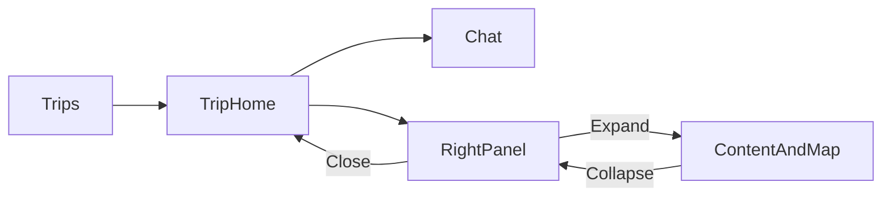

# Mindtrip interaction reference

English | [中文](mindtrip-interactions.zh.md)

## Scope

This reference describes direct browser observations of [Mindtrip](https://mindtrip.ai) on
29 October 2026 using an existing signed-in account. Trips, two Trip homes, a linked Chat,
Ideas, Itinerary, Calendar, Bookings and Trip preferences were opened without changing saved trip data or
sending a message. Desktop was inspected at 1440 × 1000; a 390 × 844 emulated viewport
exposed the mobile layout. These observations do not establish native-device behaviour,
all account variants or the outcome of unperformed edits. Private Trip and Chat URLs and
account details are deliberately omitted.

## Trip entry and navigation

1. Trips opens the account's Trip list. Trips, Calendar and Receipts are separate list-level views.
2. Opening a Trip card opens a Trip home. Its title and destination, dates or duration,
   travellers and budget controls sit above the Chat list.
3. The desktop centre shows a contextual suggestion, a counted list of linked Chats and a
   new-Chat composer at the bottom. A Trip with two Chats shows both as individual rows,
   each with its own title, date and forward arrow.
4. The desktop right column shows Ideas, Itinerary, Bookings, Media, Trip preferences and
   Calendar above the map. Counts appear where there is content.
5. A linked Chat opens a Chat URL with conversation content, a composer and a map. The
   observation does not imply that our application should discard its approved in-place Chat model.

## Right-side panels

Clicking Itinerary, Calendar or Trip preferences opens a panel from the right over the
current Trip. Closing returns to the same Trip context. The panel has Close and Expand
controls; opening it does not navigate to the global Trips calendar. Expanding Ideas fills
the workspace beside the sidebar and adds a map beside its content; Collapse restores
the narrow panel. The empty Ideas state offers an action to add ideas, rather than an inert list.

Itinerary contains an Ideas section, days, timed stops, place images, detail actions,
distances, directions and per-day map controls. Calendar presents days as columns on a
time axis, with stays in an all-day lane; a dated Trip offers a Week view selector.
An undated Trip instead labels columns by day number. These are observed controls;
dragging, editing and external booking completion were not exercised.

Trip preferences shows a dedicated text entry and an editable list of preferences. It
is separate from the destination, dates, travellers and budget controls. Merely copying
the panel shape would not establish equivalent editing or persistence behaviour.

## Conversation and map

An existing reply contains clickable place mentions, place cards and a Highlight on map
action. Cards expose Save and Added states. The map contains individual place markers and
clusters. The observation covers rendered controls and navigation, not a newly generated
reply, saving a place or provider accuracy.

The mobile Trip home exposes Up Next and counted Chats as entry points alongside the
Trip actions, with the new-Chat composer at the bottom. This is a distinct layout from
the desktop centre-and-map arrangement.

## Application mapping

The mapping below describes the existing PR #782 tree, before further implementation.

| Interaction              | AI Trip Planner behaviour and boundary                                                                                    |
| ------------------------ | ------------------------------------------------------------------------------------------------------------------------- |
| Multiple Chats per Trip  | The existing Trip home retains each linked Chat and opens it in place.                                                    |
| Composer at the bottom   | The current form follows the Chat list in normal document flow; it is not anchored to the desktop workspace bottom.       |
| Clear new-Chat entry     | The current input has an accessible name but no visible placeholder or Enter handler.                                     |
| Chat row affordance      | The list shows title and date, with no visible count or forward arrow.                                                    |
| Trip-specific input      | The composer keeps local component state and has no Trip key; isolation across direct Trip changes needs a browser check. |
| Right-side actions       | Existing drawers retain the Trip context and restore focus on close.                                                      |
| Calendar                 | The month grid is read-only and selects an Itinerary day; it does not reproduce the time-axis view.                       |
| Itinerary                | The Trip home drawer is read-only; the dedicated editor owns time/place editing.                                          |
| Trip facts               | The Trip home shows plain tags, rather than fact editor buttons.                                                          |
| Media, sharing and voice | No equivalent workflow is established here; do not add decorative controls without working data and actions.              |

The application's current UI contract lives in [Workspace UI](../workspace-ui.md).
Retain its accessibility, provider provenance and semantic styling rules when adapting
interactions; Mindtrip's branding, assets and answer text are not implementation inputs.
