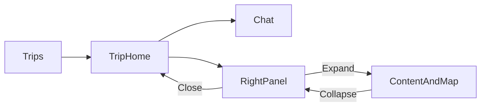

# Mindtrip 交互参考

[English](mindtrip-interactions.md) | 中文

## 范围

本文记录了 2026 年 10 月 29 日使用已有登录账户在浏览器中直接观察到的
[Mindtrip](https://mindtrip.ai) 交互。查看了 Trips、两个 Trip 首页、关联聊天、
Ideas、Itinerary、Calendar、Bookings 和 Trip preferences，没有修改已保存行程，也没有发送消息。
桌面按 1440 × 1000 查看，并使用 390 × 844 模拟视口观察手机布局。这些观察不代表
真机行为、所有账户版本或尚未执行的编辑结果。文档省略私人行程、聊天链接及账户信息。

## 行程入口和导航

1. Trips 打开账户的行程列表。Trips、Calendar、Receipts 是列表层级的独立视图。
2. 点击行程卡片进入 Trip 首页，标题下方是目的地、日期或时长、人数和预算控件，
   再下面是聊天列表。
3. 桌面中间显示上下文建议、带数量的关联聊天列表，以及底部的新聊天输入框。
   同一 Trip 中的两个聊天分别显示为独立行，每行都有标题、日期和进入箭头。
4. 桌面右侧在地图上方显示 Ideas、Itinerary、Bookings、Media、Trip preferences、
   Calendar；有内容的入口显示数量。
5. 打开关联聊天会进入 Chat URL，显示对话、输入框和地图。这个观察不意味着我们的
   应用应放弃已经批准的原位聊天模式。

## 右侧面板

点击 Itinerary、Calendar 或 Trip preferences，会在当前 Trip 上从右侧展开面板。
关闭后仍在同一行程上下文中。面板提供 Close 和 Expand 控件，打开它不会跳到全局
Trips 日历。展开 Ideas 后，面板占据侧边栏以外的工作区，内容旁边增加地图；
Collapse 会恢复窄面板。Ideas 空状态提供添加操作，而不是只有不可操作的列表。

Itinerary 包含 Ideas 区域、每日分组、带时间的停靠点、地点图片、详情入口、距离、
路线和每日地图控件。Calendar 在时间轴上按列显示每天，住宿放在全天区域；有日期
的行程提供 Week 视图选择器。没有日期的行程则用第几天作为列标题。上述内容是实际
看到的控件；没有执行拖拽、编辑或外部预订。

Trip preferences 提供独立的文本输入和可编辑偏好列表，与目的地、日期、人数、预算
控件分开。仅复制面板外形，不能证明已经具备相同的编辑和持久化行为。

## 对话和地图

已有回复包含可点击的地点名称、地点卡片和 Highlight on map 操作。卡片显示 Save、
Added 状态。地图包含独立地点标记和聚合标记。观察覆盖实际渲染的控件和导航，
没有验证新生成回复、收藏地点或供应商准确性。

手机 Trip 首页将 Up Next 和带数量的 Chats 作为入口，与各项行程操作一起展示，
底部保留新聊天输入框。这是区别于桌面中间内容加右侧地图的独立布局。

## 应用映射

下表描述进一步实现前，现有 PR #782 代码树的行为。

| 交互               | AI Trip Planner 行为及边界                                                  |
| ------------------ | --------------------------------------------------------------------------- |
| 一个 Trip 多个聊天 | 现有 Trip 首页保留每个关联聊天，并原位打开。                                |
| 底部输入框         | 当前表单按普通文档流跟在聊天列表之后，没有固定在桌面工作区底部。            |
| 明确的新聊天入口   | 当前输入框有无障碍名称，但没有可见占位提示，也没有 Enter 处理。             |
| 聊天行可操作性     | 列表显示标题和日期，没有可见数量或进入箭头。                                |
| 输入属于具体行程   | 输入框使用组件本地状态，没有 Trip key；直接切换行程时的隔离还需浏览器验证。 |
| 右侧操作           | 现有抽屉保留行程上下文，关闭后恢复焦点。                                    |
| Calendar           | 当前月历只读，选择日期会进入对应 Itinerary 天；尚未实现时间轴视图。         |
| Itinerary          | Trip 首页抽屉目前只读，时间和地点编辑由专用编辑器负责。                     |
| 行程事实           | Trip 首页显示普通标签，而不是各项事实的编辑按钮。                           |
| 媒体、分享和语音   | 本次没有建立对应流程；不要添加缺少数据和有效操作的装饰性控件。              |

应用的当前界面契约见[工作区界面](../workspace-ui.zh.md)。借鉴交互时保留无障碍、
供应商来源和语义样式规则；Mindtrip 的品牌、素材和回复原文不作为实现输入。
