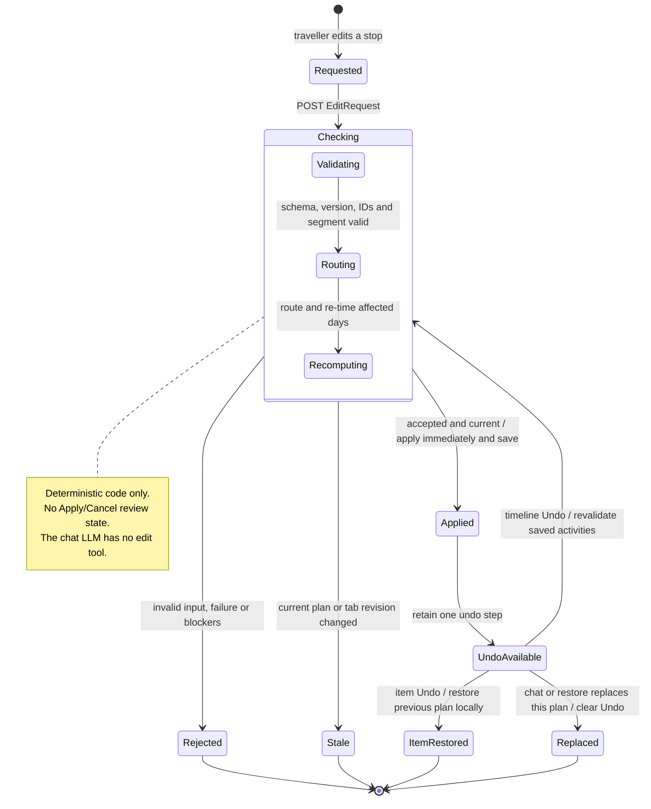

# 4. Behaviour models: member E (`@WhW0591`, chat workspace, timeline and map editing)

English | [中文](04-member-e-behaviour.zh.md)

These models derive from **AH-E1 / R-E1–R-E6** in [Requirements](01-requirements.md#member-e-ah-e1) and
**UC-E1 Edit Itinerary (Timeline / Map)** in [Use cases](02-use-cases.md#uc-e1-edit-itinerary-timeline--map).
Timeline and map edits are deterministic: the browser applies an accepted, current result immediately
and offers Undo. There is no Apply/Cancel review checkpoint. The chat coordinator can update the brief
or replan but has no `EditRequest` tool. The [immediate-edit decision](../../../.agents/notes/implemented/feature/2026-10-08-immediate-timeline-edits.md)
and [Trip editing decision](../../../.agents/notes/implemented/feature/2026-10-27-itinerary-interaction.md) explain these controls.

## 4.1 Activity diagram: Edit Itinerary (UC-E1)

```mermaid
flowchart TB
  start(( )) --> how{"Edit on Timeline / Map, or ask in chat?"}
  how -- edit --> pick
  how -- chat --> chat

  subgraph T["Traveller"]
    how
    pick["Move, retime, remove or schedule a stop"]
    undo{"Undo the last applied edit?"}
    chat["Ask for a change in chat"]
  end

  subgraph W["Web workspace (browser)"]
    send["POST EditRequest: plan, baseVersion, operation"]
    blocked{"Any blockers?"}
    fresh{"Current plan and tab revision still match?"}
    apply["Apply accepted plan immediately, save locally, offer Undo"]
    restore["Restore item snapshot, or send checked timeline undo"]
    stale["Discard stale result; keep current plan"]
    err["Show error; plan unchanged"]
  end

  subgraph P["Deterministic edit route"]
    check{"Schema, version, IDs and segment rules pass?"}
    retime["Route and re-time affected days with 15 min buffer"]
    recompute["Recompute conflicts, costs and price flags; editVersion + 1"]
  end

  subgraph G["Maps / Routes / Places"]
    maps["Place details, time zone, route duration"]
  end

  subgraph C["Chat coordinator (LLM, UC-A1)"]
    replan["Update brief or replan; has no edit tool"]
  end

  pick --> send --> check
  check -- no --> err --> stop(((●)))
  check -- yes --> retime
  retime <--> maps
  retime --> recompute --> fresh
  fresh -- no --> stale --> stop
  fresh -- yes --> blocked
  blocked -- yes --> err
  blocked -- no --> apply --> undo
  undo -- no --> stop
  undo -- yes --> restore --> stop
  chat --> replan --> stop
  style start fill:#14213D,stroke:#14213D
  style stop fill:#FFFFFF,stroke:#14213D
```



The browser checks the current plan and tab revision before applying the server's answer. Blockers
leave the plan unchanged; an accepted edit applies without another traveller decision. The Undo action
is available only while its edited plan remains current.

## 4.2 Sequence diagram: Timeline/Map edit with version check and Undo (UC-E1)

```mermaid
sequenceDiagram
  autonumber
  actor T as Traveller
  participant W as Web workspace
  participant P as /api/trip/preview-edit
  participant G as Maps / Routes / Places
  participant CC as Chat coordinator (LLM)

  T->>W: Move, retime, remove or schedule a stop
  W->>P: EditRequest (plan, baseVersion, operation)
  P->>P: Check schema, editVersion, IDs and segment rules
  alt Invalid or stale request
    P-->>W: Error with reason
    W-->>T: Error, plan unchanged
  else Valid
    loop Affected route legs
      P->>G: Place details, time zone and route duration
      G-->>P: Evidence or unavailable result
      P->>P: Re-time with route + 15 min or record blocker
    end
    P->>P: Recompute conflicts, costs, price flags and editVersion
    P-->>W: Checked plan, differences, routes and blockers
    alt Current plan or tab revision changed
      W->>W: Discard answer; keep current plan
    else Blockers present
      W-->>T: Show blockers; keep current plan
    else Accepted and current
      W->>W: Keep undo step, apply immediately, save locally
      W-->>T: Updated Timeline / Map and Undo action
      opt Traveller chooses Undo
        alt Remove, idea, schedule or local item edit
          W->>W: Restore the previous item-edit plan locally
        else Timeline time, place, drag or leg edit
          W->>P: Undo operation with saved scheduled activities
          P-->>W: Revalidated result
          W->>W: Apply only if accepted and still current
        end
      end
    end
  end

  Note over T,CC: Chat is a separate path, with no EditRequest tool
  T->>CC: Chat message
  CC-->>W: Updated brief or replacement plan
  W->>W: A replacement plan clears the previous Undo
```

The API name `preview-edit` describes a deterministic check, not a user-facing preview screen. The
browser holds the undo state. Item Undo restores the previous plan for remove, idea, schedule and
local item edits; timeline Undo revalidates the saved scheduled activities through the edit route.
A replacement plan from chat clears both kinds of undo. Browser storage is the local persistence
boundary; no server-side atomic commit is claimed.

## 4.3 State machine: Timeline/Map edit lifecycle (UC-E1)



An accepted result moves directly from checking to applied, with one undo step. A refused or stale
result never overwrites the current plan. Background place saves and route checks preserve Undo and
their unrelated updates. Navigation retains the step for its Trip, without exposing it on another
Trip. A replacement plan from chat or restore clears the step; reload clears all in-memory steps.
Chat interpretation and confirmation before replacing manual changes remain outside this deterministic
state machine.
