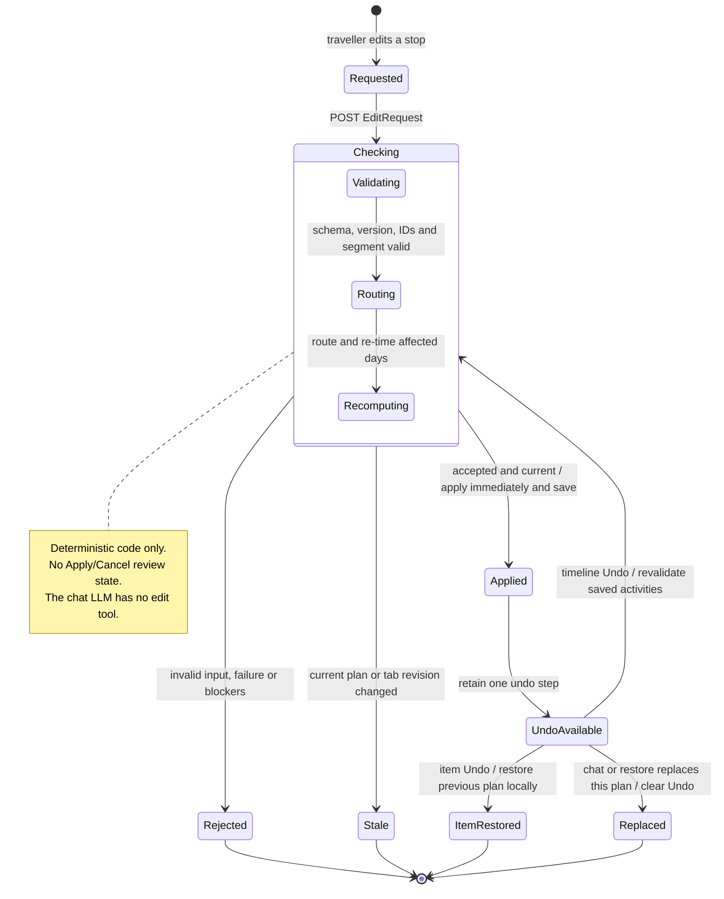

<a id="4-behaviour-models-member-e-whw0591-chat-workspace-timeline-and-map-editing"></a>

# 4. 行为模型：成员 E（`@WhW0591`，聊天工作区、时间线与地图编辑）

[English](04-member-e-behaviour.md) | 中文

这些模型源自[需求](01-requirements.zh.md#member-e-ah-e1)中的 **AH-E1 / R-E1–R-E6** 和[用例](02-use-cases.zh.md#uc-e1-edit-itinerary-timeline--map)中的
**UC-E1 Edit Itinerary (Timeline / Map)**。时间线和地图编辑是确定性的：浏览器立即应用被接受且仍然有效的结果，
并提供撤销。没有 Apply/Cancel 审核检查点。聊天协调员可以更新行程需求或重新规划，但没有 `EditRequest` 工具。
[即时编辑决策](../../../.agents/notes/implemented/feature/2026-10-08-immediate-timeline-edits.md)和
[行程编辑决策](../../../.agents/notes/implemented/feature/2026-10-27-itinerary-interaction.md)说明这些控制规则。

<a id="41-activity-diagram-edit-itinerary-uc-e1"></a>

## 4.1 活动图：Edit Itinerary（UC-E1）

```mermaid
flowchart TB
  start(( )) --> how{"Edit on Timeline / Map, or ask in chat?"}
  how -- edit --> pick
  how -- chat --> chat

  subgraph T["Traveller"]
    how
    pick["Move, retime, remove or schedule a stop"]
    undo{"Undo the last applied edit?"}
    chat["Ask for a change in chat"]
  end

  subgraph W["Web workspace (browser)"]
    send["POST EditRequest: plan, baseVersion, operation"]
    blocked{"Any blockers?"}
    fresh{"Current plan and tab revision still match?"}
    apply["Apply accepted plan immediately, save locally, offer Undo"]
    restore["Restore item snapshot, or send checked timeline undo"]
    stale["Discard stale result; keep current plan"]
    err["Show error; plan unchanged"]
  end

  subgraph P["Deterministic edit route"]
    check{"Schema, version, IDs and segment rules pass?"}
    retime["Route and re-time affected days with 15 min buffer"]
    recompute["Recompute conflicts, costs and price flags; editVersion + 1"]
  end

  subgraph G["Maps / Routes / Places"]
    maps["Place details, time zone, route duration"]
  end

  subgraph C["Chat coordinator (LLM, UC-A1)"]
    replan["Update brief or replan; has no edit tool"]
  end

  pick --> send --> check
  check -- no --> err --> stop(((●)))
  check -- yes --> retime
  retime <--> maps
  retime --> recompute --> fresh
  fresh -- no --> stale --> stop
  fresh -- yes --> blocked
  blocked -- yes --> err
  blocked -- no --> apply --> undo
  undo -- no --> stop
  undo -- yes --> restore --> stop
  chat --> replan --> stop
  style start fill:#14213D,stroke:#14213D
  style stop fill:#FFFFFF,stroke:#14213D
```



浏览器在应用服务器响应前检查当前计划和标签页版本。阻断项会使计划保持不变；被接受的编辑直接应用，
无需旅行者再次决定。撤销操作仅在该编辑后的计划仍然有效时可用。

<a id="42-sequence-diagram-timelinemap-edit-with-version-check-and-undo-uc-e1"></a>

## 4.2 时序图：带版本检查和撤销的时间线/地图编辑（UC-E1）

```mermaid
sequenceDiagram
  autonumber
  actor T as Traveller
  participant W as Web workspace
  participant P as /api/trip/preview-edit
  participant G as Maps / Routes / Places
  participant CC as Chat coordinator (LLM)

  T->>W: Move, retime, remove or schedule a stop
  W->>P: EditRequest (plan, baseVersion, operation)
  P->>P: Check schema, editVersion, IDs and segment rules
  alt Invalid or stale request
    P-->>W: Error with reason
    W-->>T: Error, plan unchanged
  else Valid
    loop Affected route legs
      P->>G: Place details, time zone and route duration
      G-->>P: Evidence or unavailable result
      P->>P: Re-time with route + 15 min or record blocker
    end
    P->>P: Recompute conflicts, costs, price flags and editVersion
    P-->>W: Checked plan, differences, routes and blockers
    alt Current plan or tab revision changed
      W->>W: Discard answer; keep current plan
    else Blockers present
      W-->>T: Show blockers; keep current plan
    else Accepted and current
      W->>W: Keep undo step, apply immediately, save locally
      W-->>T: Updated Timeline / Map and Undo action
      opt Traveller chooses Undo
        alt Remove, idea, schedule or local item edit
          W->>W: Restore the previous item-edit plan locally
        else Timeline time, place, drag or leg edit
          W->>P: Undo operation with saved scheduled activities
          P-->>W: Revalidated result
          W->>W: Apply only if accepted and still current
        end
      end
    end
  end

  Note over T,CC: Chat is a separate path, with no EditRequest tool
  T->>CC: Chat message
  CC-->>W: Updated brief or replacement plan
  W->>W: A replacement plan clears the previous Undo
```

API 名称 `preview-edit` 表示确定性检查，不表示面向用户的预览页面。撤销状态由浏览器保存。
对于 remove、idea、schedule 和本地条目编辑，条目撤销会恢复先前计划；时间线撤销则通过编辑路由
重新校验保存的已安排活动。聊天返回的替换计划会清除这两种撤销。浏览器存储是本地持久化边界，
这里不声称存在服务器端原子提交。

<a id="43-state-machine-timelinemap-edit-lifecycle-uc-e1"></a>

## 4.3 状态机：时间线/地图编辑的生命周期（UC-E1）



被接受的结果从检查状态直接进入已应用状态，并保留一个撤销步骤。被拒绝或过期的结果不会覆盖当前计划。
后台地点保存和路线检查会保留撤销，以及它们产生的无关更新。导航时该步骤随所属旅行保留，不会显示在其他
旅行上。聊天或恢复操作替换计划时会清除该步骤；重新加载会清除所有内存中的步骤。
聊天解释以及替换手动更改前的确认仍然位于此确定性状态机之外。
