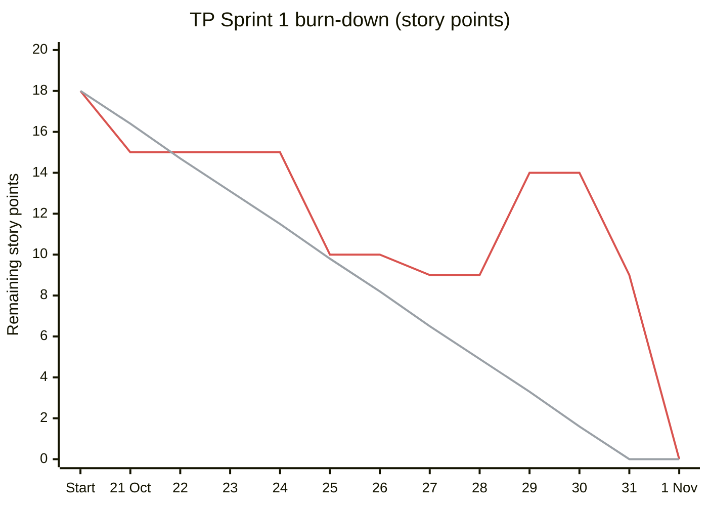
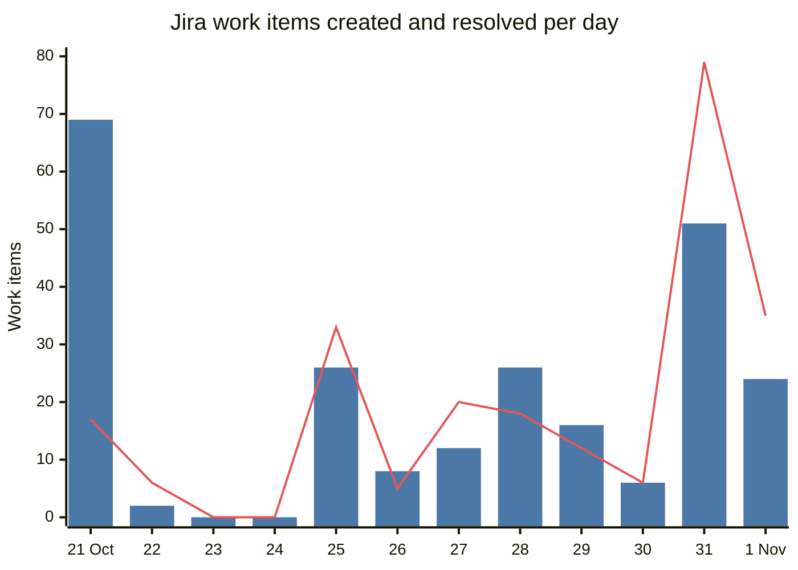

# ELEC5620 Stage 2 demonstration evidence

English | [中文](demo-evidence.zh.md)

The unit does not ask for a written Stage 2 report: it asks for the source code, the group
contribution statement and a live demonstration
([prototype brief](prototype-brief.md)). This page is the presenters' evidence sheet. It maps each
[demonstration criterion](demo-marking-criteria.md) to what to show live and to numbers anyone can
check. Figures were taken from `main` at `9149d87` and from Jira project TP on 1 November 2026.

## 1. Comprehensiveness of functions and features (7)

| Evidence                 | Figure                                                                                                                                                                       | Where                                                                                        |
| ------------------------ | ---------------------------------------------------------------------------------------------------------------------------------------------------------------------------- | -------------------------------------------------------------------------------------------- |
| Stage 1 design traced    | Every Stage 1 use case and class model has a page that names the code that implements it                                                                                     | [Stage 1 design model](../stage1/README.md), [class diagrams](../class-diagram.md)           |
| Unit and component tests | 137 test files, 1,504 tests in six packages (`pnpm test`, 1 November 2026)                                                                                                   | `packages/*/tests`, `apps/web/tests`                                                         |
| Browser journeys         | 97 end-to-end scripts; CI picks the ones a change touches and runs the full set on every push to `main`                                                                      | `apps/web/tests/e2e`, `apps/web/tests/cli-e2e`                                               |
| Edge cases               | Infeasible budget, stalled revision and round-limit stops; Google key rejected; live data unavailable; refresh during a reply; signed-out access (24/24 real-session checks) | [agent-lab-exit-paths.md](../../../submission/stage2/agent-lab-exit-paths.md), TP-62, TP-238 |
| Clean install            | A fresh `git archive` of `main` installs and builds in about 1 min 36 s                                                                                                      | [submission README](../../../submission/stage2/README.md)                                    |

Show live: one trip planned end to end in chat, then the itinerary, map, budget and an edit on the
Trip page, on desktop and on a phone-width window.

## 2. AI agent: perception, decision-making and interaction (4)

| Capability      | What the agents do                                                                                                                                                                                                                                        | Where                                                 |
| --------------- | --------------------------------------------------------------------------------------------------------------------------------------------------------------------------------------------------------------------------------------------------------- | ----------------------------------------------------- |
| Perception      | The brief model turns free text into destinations, dates, party, budget and intent (pace, diet, interests); tools read live flights, stays, places, routes and weather                                                                                    | `packages/agents`, `packages/tools`, PR #850 (TP-202) |
| Decision-making | A LangGraph workflow: a supervisor chooses specialists, the graph checks budget and timing conflicts, sends only the agents involved back for revision, and stops with a named reason (`converged`, `infeasible_budget`, `no_improvement`, `round_limit`) | `packages/orchestrator`                               |
| Interaction     | Five specialist assistants, `@`-mentions and hand-offs, the Agent Team panel and the Trajectory record of each run; a reply survives a page refresh                                                                                                       | `apps/web`, PR #888 (TP-238)                          |

Data behind the design, from repeatable Agent Lab runs on the same A$2,300 trip
([agent-lab-exit-paths.md](../../../submission/stage2/agent-lab-exit-paths.md)):

| Strategy                            | Estimate | Over budget             |
| ----------------------------------- | -------- | ----------------------- |
| One agent planning alone            | A$3,960  | +A$1,660                |
| Five specialists, no revision       | A$2,560  | +A$260                  |
| Five specialists, targeted revision | A$2,120  | within, one extra round |

Improvement from feedback: a full live trip test on 30 October found 22 problems (flight pricing,
the day plan starting before the flight landed, maps after Google refused the key, and others). Each
became a Jira story and was fixed in TP-194 to TP-223 (PRs #837 to #870) within two days.

## 3. Agile development experience (4)

| Practice           | Evidence                                                                                                                                                                                                    |
| ------------------ | ----------------------------------------------------------------------------------------------------------------------------------------------------------------------------------------------------------- |
| User stories       | Jira project TP: 240 issues, 231 done. Stories are written as "As a traveller, I …" with acceptance criteria                                                                                                |
| Iterations         | TP Sprint 1 (21 to 31 October, 19 issues, closed 1 November). Before Jira, weekly iterations are visible in Git: 795 commits on `main` from 24 August, with weekly peaks of 133 (week 41) and 243 (week 43) |
| Traceability       | Every pull request title carries its TP key, so Jira links story, branch, commits and PR; 403 pull requests merged                                                                                          |
| Feedback loops     | Code review and CI on every pull request; five recorded retrospectives (two on 8 October, then 24, 28 and 30 October) whose actions changed the team rules; the live trip test above                        |
| Decisions recorded | Agent Notes under [`.agents/notes/`](../../../.agents/notes/README.md) and 700+ dated session logs                                                                                                          |
| Collaboration      | Five members, each owning two core features and one optional feature; the order of the live demo follows that split                                                                                         |

The burn-down is rebuilt from the Jira change history of each TP Sprint 1 issue: when it joined the
sprint, its story points and when it was resolved. Values are at the end of each day (AEDT); the
red line is remaining work and the grey line the ideal rate from 18 points on 21 October to zero on 31 October.

| Date       | Scope change                                                      | Story points |
| ---------- | ----------------------------------------------------------------- | ------------ |
| 21 October | Sprint starts with 11 stories                                     | 18           |
| 21 October | TP-16 and TP-17 added and done the same day                       | +5           |
| 29 October | TP-45 (edit review step) and TP-62 (signed-out access test) added | +7           |
| 1 November | TP-225, TP-226, TP-231 and TP-233 added and done, not estimated   | 0            |

Remaining work rose on 29 October and fell to zero on 1 November, when the sprint was closed, one
day after its planned end.

Blue bars are work items created each day and the red line is work items resolved each day, from 240 Jira
issues read on 1 November. The 69 items on 21 October are the backlog moved into Jira from GitHub
Issues when the team adopted it. After that, new stories and finished stories track each other day
by day, and the two peaks on 31 October and 1 November are the live trip test fixes and the Stage 2
submission work.

| Status | Items |     | Type  | Items |     | Assignee     | Items |
| ------ | ----- | --- | ----- | ----- | --- | ------------ | ----- |
| Done   | 231   |     | Story | 224   |     | Joey         | 201   |
| To Do  | 9     |     | Epic  | 13    |     | Stan He      | 12    |
|        |       |     | Bug   | 2     |     | Jiahang Bian | 9     |
|        |       |     | Task  | 1     |     | Tingsong Jin | 8     |
|        |       |     |       |       |     | Weihao Wang  | 4     |
|        |       |     |       |       |     | Unassigned   | 6     |

Lead time from creation to resolution: the median story took 2.6 hours (mean 34.7 hours), 68% of
all resolved items were closed within a day of being created, and the median epic stayed open for
9.7 days while its stories were delivered.

Jira was adopted on 21 October; the weekly commit counts above show the earlier iterations.

## 4. Incorporation of advanced technologies (5)

| Technology                                                  | What it improves                                 | Measured                                                                                                                                          |
| ----------------------------------------------------------- | ------------------------------------------------ | ------------------------------------------------------------------------------------------------------------------------------------------------- |
| LangGraph and LangChain multi-agent workflow                | Plan quality under a budget                      | Targeted revision A$2,120 against A$3,960 for a single agent on an A$2,300 budget (table above)                                                   |
| DeepSeek model routing with a deterministic fallback        | Response time                                    | MiniMax took 15 to 25 s per structured call (37 to 81 s per page); DeepSeek about 20 s per page (`.env.example`, `packages/agents/src/models.ts`) |
| Next.js 15 and React 19 streaming with durable turns        | Interaction and reliability                      | A reply in progress survives a page refresh and is replayed by run id (PR #888)                                                                   |
| Installable app with a phone layout                         | Reach on mobile devices                          | 23/23 installability checks passed (manifest, icons, offline page)                                                                                |
| Cloud services: Vercel, Clerk, Neon Postgres, Upstash Redis | Scalability and security without running servers | 24/24 real-session checks: sign-in, token expiry, cross-account isolation, sign-out (TP-62)                                                       |
| Maps with fallback: Google Maps, OpenStreetMap, MapLibre    | Availability                                     | Maps, routes and places keep working with Google's key rejected (PR #840, TP-198)                                                                 |
| CI/CD: GitHub Actions, Turborepo, Docker                    | Maintainability and delivery speed               | Median PR CI time fell from 7.3 min (29 runs) to 5.3 min (29 runs) after PR #880 chose browser tests by change; 403 PRs merged through it         |

Show live: the Trajectory of one run, Agent Lab comparing strategies, the phone layout, and a green
CI run on a merged pull request.
