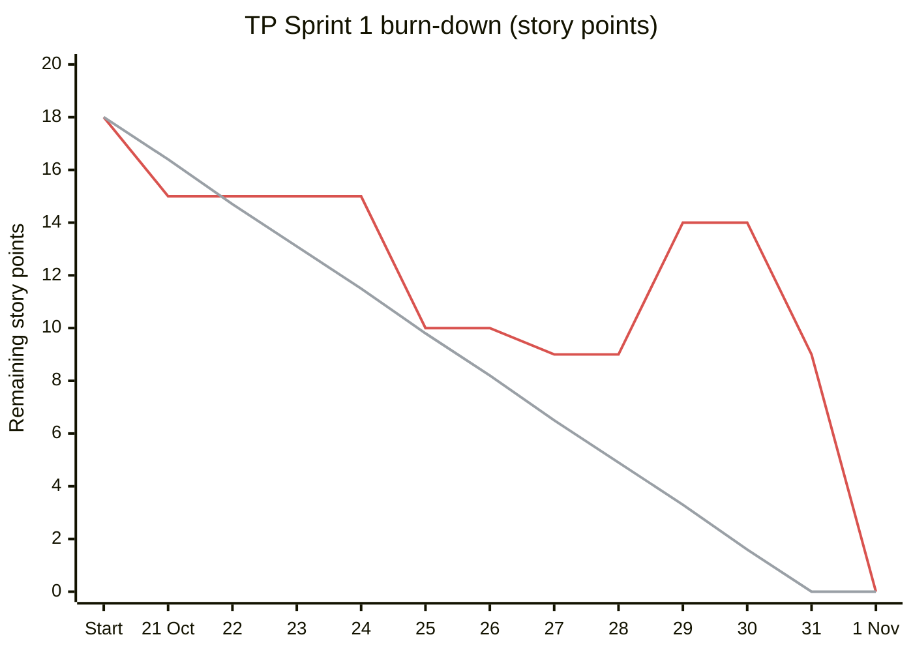
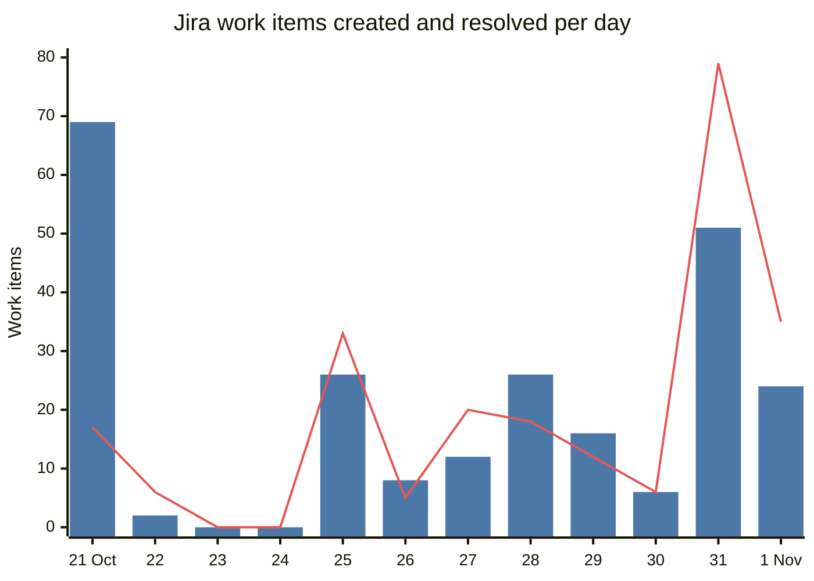

# ELEC5620 Stage 2 演示证据

[English](demo-evidence.md) | 中文

课程不要求 Stage 2 交书面报告，要交的是源代码、小组贡献声明表和现场演示
（[任务说明](prototype-brief.zh.md)）。本页是演示者的证据清单：把每一项
[演示评分标准](demo-marking-criteria.zh.md)对应到现场要展示的内容和可核对的数字。数字取自 2026 年 11 月 1 日
`main` 的 `9149d87` 和 Jira 项目 TP。

## 1. 功能与特性的完整性（7）

| 证据               | 数字                                                                                                                     | 位置                                                                                         |
| ------------------ | ------------------------------------------------------------------------------------------------------------------------ | -------------------------------------------------------------------------------------------- |
| Stage 1 设计可追溯 | 每个 Stage 1 用例和类模型都有页面写明实现它的代码                                                                        | [Stage 1 设计模型](../stage1/README.zh.md)、[类图](../class-diagram.zh.md)                   |
| 单元和组件测试     | 六个包共 137 个测试文件、1,504 个测试（`pnpm test`，2026 年 11 月 1 日）                                                 | `packages/*/tests`、`apps/web/tests`                                                         |
| 浏览器旅程         | 97 个端到端脚本；CI 按改动选脚本，推到 `main` 时全部运行                                                                 | `apps/web/tests/e2e`、`apps/web/tests/cli-e2e`                                               |
| 边界情况           | 预算不可行、返工停滞和轮数上限的停止；Google key 被拒；真实数据不可用；回复中途刷新；未登录访问（真实会话 24/24 项通过） | [agent-lab-exit-paths.md](../../../submission/stage2/agent-lab-exit-paths.md)、TP-62、TP-238 |
| 全新安装           | `main` 的全新 `git archive` 安装并构建约 1 分 36 秒                                                                      | [提交说明](../../../submission/stage2/README.md)                                             |

现场展示：在聊天里完整规划一次行程，再在行程页看日程、地图、预算并改一次，桌面和手机宽度各看一遍。

## 2. AI Agent：感知、决策与交互（4）

| 能力 | Agent 做什么                                                                                                                                                          | 位置                                                   |
| ---- | --------------------------------------------------------------------------------------------------------------------------------------------------------------------- | ------------------------------------------------------ |
| 感知 | 需求模型把自由文本转成目的地、日期、出行人、预算和意图（节奏、饮食、兴趣）；工具读取实时航班、住宿、地点、路线和天气                                                  | `packages/agents`、`packages/tools`、PR #850（TP-202） |
| 决策 | LangGraph 工作流：supervisor 选专家，图检查预算和时间冲突，只让相关 agent 返工，并以明确原因停止（`converged`、`infeasible_budget`、`no_improvement`、`round_limit`） | `packages/orchestrator`                                |
| 交互 | 五个专家助手、`@` 提及和交接、专家团队面板和每次运行的执行轨迹；回复中途刷新页面也不会丢                                                                              | `apps/web`、PR #888（TP-238）                          |

设计背后的数据，来自同一个 A$2,300 行程的可重复 Agent Lab 运行
（[agent-lab-exit-paths.md](../../../submission/stage2/agent-lab-exit-paths.md)）：

| 策略                | 估价    | 超预算         |
| ------------------- | ------- | -------------- |
| 单个 agent 独自规划 | A$3,960 | +A$1,660       |
| 五个专家，不返工    | A$2,560 | +A$260         |
| 五个专家，定向返工  | A$2,120 | 预算内，多一轮 |

基于反馈的改进：10 月 30 日一次完整的真实行程测试发现 22 个问题（航班计价、日程在航班落地前就开始、Google 拒绝
key 后的地图等）。每个问题建成 Jira 故事，两天内在 TP-194 到 TP-223（PR #837 到 #870）修复。

## 3. 敏捷开发经验（4）

| 实践     | 证据                                                                                                                                                                        |
| -------- | --------------------------------------------------------------------------------------------------------------------------------------------------------------------------- |
| 用户故事 | Jira 项目 TP：240 个条目，231 个已完成。故事按"作为旅行者，我……"书写并带验收标准                                                                                            |
| 迭代     | TP Sprint 1（10 月 21 日到 31 日，19 个条目，11 月 1 日关闭）。在用 Jira 之前，迭代体现在 Git 里：8 月 24 日起 `main` 共 795 个提交，第 41 周 133 个、第 43 周 243 个是高峰 |
| 可追溯   | 每个 PR 标题带 TP 编号，Jira 把故事、分支、提交和 PR 连在一起；共合并 403 个 PR                                                                                             |
| 反馈循环 | 每个 PR 都有代码评审和 CI；五次有记录的回顾（10 月 8 日两次，之后 24、28、30 日），其行动项改了团队规则；以及上面的真实行程测试                                             |
| 决策记录 | [`.agents/notes/`](../../../.agents/notes/README.md) 下的 Agent Notes 和 700 多份带日期的 session log                                                                       |
| 团队协作 | 五名成员各负责两个核心功能和一个可选功能；现场演示的顺序就按这个分工                                                                                                        |

燃尽图由 TP Sprint 1 每个条目的 Jira 变更历史重建：何时加入冲刺、故事点数、何时完成。取每天结束时的值（悉尼时间）；红线是剩余工作量，灰线是理想速率，从 10 月 21 日的 18 点降到 10 月 31 日的零。

| 日期        | 范围变更                                             | 故事点 |
| ----------- | ---------------------------------------------------- | ------ |
| 10 月 21 日 | 冲刺以 11 个故事开始                                 | 18     |
| 10 月 21 日 | 加入 TP-16 和 TP-17，当天完成                        | +5     |
| 10 月 29 日 | 加入 TP-45（编辑预览步骤）和 TP-62（未登录访问测试） | +7     |
| 11 月 1 日  | 加入并完成 TP-225、TP-226、TP-231 和 TP-233，未估点  | 0      |

剩余工作量在 10 月 29 日回升，11 月 1 日关闭冲刺时降到零，比计划结束晚一天。

蓝柱是每天新建的条目，红线是每天完成的条目，数据来自 11 月 1 日读取的 240 个 Jira 条目。10 月 21 日的 69 个是团队开始用 Jira 时从 GitHub Issues 迁入的待办。之后每天新建和完成的故事基本同步，10 月 31 日和 11 月 1 日的两个高峰是真实行程测试的修复和 Stage 2 提交前的工作。

| 状态   | 条目 |     | 类型     | 条目 |     | 负责人       | 条目 |
| ------ | ---- | --- | -------- | ---- | --- | ------------ | ---- |
| 已完成 | 231  |     | 故事     | 224  |     | Joey         | 201  |
| 待办   | 9    |     | 长篇故事 | 13   |     | Stan He      | 12   |
|        |      |     | 缺陷     | 2    |     | Jiahang Bian | 9    |
|        |      |     | 任务     | 1    |     | Tingsong Jin | 8    |
|        |      |     |          |      |     | Weihao Wang  | 4    |
|        |      |     |          |      |     | 未分配       | 6    |

从创建到完成的前置时间：故事的中位数是 2.6 小时（平均 34.7 小时），68% 的已完成条目在创建后一天内关闭，长篇故事的中位数是 9.7 天，期间其下的故事陆续交付。

团队从 10 月 21 日开始用 Jira；更早的迭代见上面的每周提交数。

## 4. 先进技术的运用（5）

| 技术                                                | 改进了什么                   | 实测                                                                                                                             |
| --------------------------------------------------- | ---------------------------- | -------------------------------------------------------------------------------------------------------------------------------- |
| LangGraph 和 LangChain 多 agent 工作流              | 预算约束下的计划质量         | A$2,300 预算下定向返工 A$2,120，单 agent A$3,960（见上表）                                                                       |
| DeepSeek 模型路由加确定性回退                       | 响应时间                     | MiniMax 每次结构化调用 15 到 25 秒（每页 37 到 81 秒）；DeepSeek 每页约 20 秒（`.env.example`、`packages/agents/src/models.ts`） |
| Next.js 15 和 React 19 流式输出与持久回合           | 交互和可靠性                 | 进行中的回复在页面刷新后按 run id 重放，不会丢（PR #888）                                                                        |
| 可安装应用和手机布局                                | 移动设备覆盖                 | 可安装性检查 23/23 通过（manifest、图标、离线页）                                                                                |
| 云服务：Vercel、Clerk、Neon Postgres、Upstash Redis | 不自建服务器的可扩展性和安全 | 真实会话检查 24/24 通过：登录、令牌过期、跨账号隔离、退出（TP-62）                                                               |
| 地图回退：Google Maps、OpenStreetMap、MapLibre      | 可用性                       | Google key 被拒时地图、路线和地点仍可用（PR #840，TP-198）                                                                       |
| CI/CD：GitHub Actions、Turborepo、Docker            | 可维护性和交付速度           | PR #880 按改动选浏览器测试后，PR 的 CI 中位时长从 7.3 分钟（29 次）降到 5.3 分钟（29 次）；403 个 PR 都经它合并                  |

现场展示：一次运行的执行轨迹、Agent Lab 对比策略、手机布局，以及一个已合并 PR 的绿色 CI。
